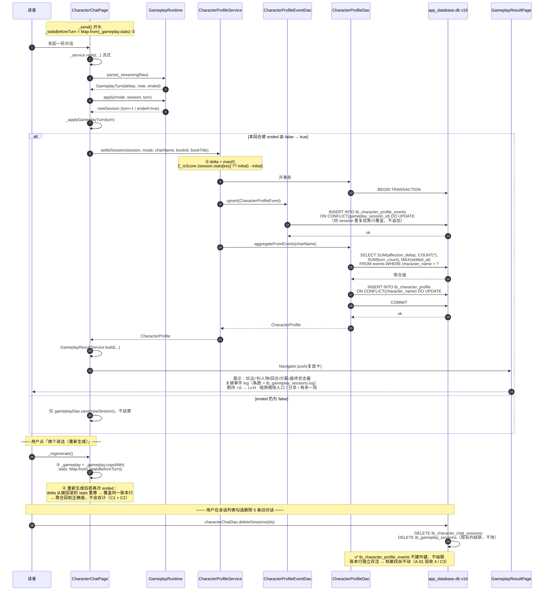
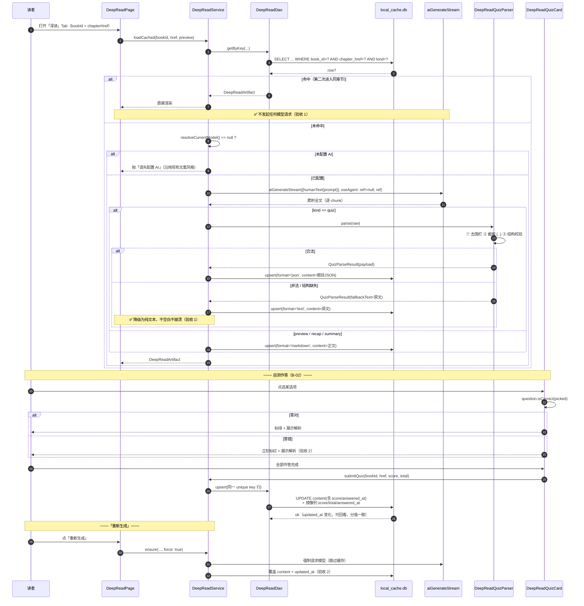
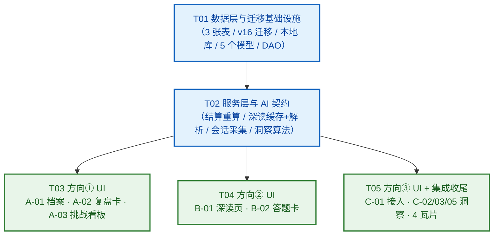

# 松江阅 · 新功能架构设计与任务分解

| 项    | 内容                                              |
| ---- | ----------------------------------------------- |
| 项目   | 松江阅 · SongJiang Reader（`D:\xiangmu\sojiangyue`） |
| 上游输入 | `docs/PRD-新功能-2026-10-07.md`（许清楚 / 产品）          |
| 文档语言 | 简体中文                                            |
| 版本   | v1.0                                            |
| 日期   | 2026-10-07                                      |
| 作者   | 高见远（架构）                                         |
| 范围   | ① 角色×玩法生态 ② AI 深度阅读增强 ③ 阅读数据与洞察（P0 全部 + P1 主体）  |

---


## 0. 代码复核结论（设计前逐条核对，非转述 PRD）

以下结论均由本人在仓库中实际读码得出，是本设计全部接口签名与表名的依据。

| #  | 复核项                            | 结论                                                                                                                                                                                                                                                                                                                                                                 | 依据文件                                                                                                                                                                                                                                         |
| -- | ------------------------------ | ------------------------------------------------------------------------------------------------------------------------------------------------------------------------------------------------------------------------------------------------------------------------------------------------------------------------------------------------------------------ | -------------------------------------------------------------------------------------------------------------------------------------------------------------------------------------------------------------------------------------------- |
| 1  | DB 当前版本                        | `const int currentDbVersion = 15`                                                                                                                                                                                                                                                                                                                                  | `lib/dao/database.dart:19`                                                                                                                                                                                                                   |
| 2  | 迁移写法                           | `onUpgradeDatabase(db, old, new)` 用 `switch(oldVersion)` + `continue caseN` 级联；新表走 `applyXxxSchema(db)`；自建库从 `case 0` 级联到最新                                                                                                                                                                                                                                        | `lib/dao/database.dart:350-546`                                                                                                                                                                                                              |
| 3  | 迁移兜底                           | `ensureSchemaIntegrity(db)` 每次开库幂等补齐；列用 `_ensureColumn(db, table, col, type)`（PRAGMA 判存在再 ALTER）                                                                                                                                                                                                                                                                   | `lib/dao/database.dart:560-598`                                                                                                                                                                                                              |
| 4  | **迁移中禁止调 DAO**                 | `case3` 注释明确记载：迁移里调 DAO 会二次 `openDatabase` 复入同一把锁抛 `Bad state: inner synchronized block`                                                                                                                                                                                                                                                                           | `lib/dao/database.dart:420-431`                                                                                                                                                                                                              |
| 5  | 玩法会话表                          | `tb_gameplay_sessions(id, chat_session_id, mode_id, stats, turn, phase_index, secret, revealed, ended, log, created_at, updated_at)`                                                                                                                                                                                                                               | `lib/dao/gameplay_schema.dart:11-26`                                                                                                                                                                                                         |
| 6  | 玩法模型                           | `GameplayStatDef{key,name,initial,min,max,hint,isScore}`；`GameplayMode{id,name,stats,phases,setupPrompt,secretLabel,endingHint}`                                                                                                                                                                                                                                   | `lib/models/gameplay_mode.dart`                                                                                                                                                                                                              |
| 7  | 回合结算                           | `GameplayRuntime.apply()` 按 `def.min/max` clamp 累加；`ended` 为**单调或**（`session.ended \|\| turn.ended`），不可回退                                                                                                                                                                                                                                                          | `lib/service/gameplay/gameplay_runtime.dart:183-231`                                                                                                                                                                                         |
| 8  | 🧮 `_statsBeforeTurn`          | `character_chat_page.dart:82`；`_send()` 开头拍快照（302-303）；`_regenerate()` 用它回滚 stats（433-437）。**只回滚 stats，不回滚 turn/log/ended**                                                                                                                                                                                                                                        | `lib/page/character/character_chat_page.dart`                                                                                                                                                                                                |
| 9  | 状态量初值                          | 建局即写入 `stats: {for d in mode.stats: d.key: d.initial}`                                                                                                                                                                                                                                                                                                             | `character_chat_page.dart:179-183`                                                                                                                                                                                                           |
| 10 | 内置 isScore 状态量                 | `clue`(0~~6)、`closeness`(0~~100) 等，`min = initial = 0`，故增量恒 ≥ 0                                                                                                                                                                                                                                                                                                    | `lib/service/gameplay/gameplay_modes.dart`                                                                                                                                                                                                   |
| 11 | 角色 DAO                         | `CharacterDao`（`tableCard = 'tb_character_cards'`…），`transaction()` 批量写法、`saveCharacterWithRename` 改名级联                                                                                                                                                                                                                                                            | `lib/dao/character_dao.dart`                                                                                                                                                                                                                 |
| 12 | 会话列表回看缺口                       | `_open(session)` 推 `CharacterChatPage(session: …)` 时**未传 `gameplayMode`**，导致历史对局重开后玩法运行时不加载（`_initGameplay` 直接 return）                                                                                                                                                                                                                                             | `character_chat_sessions_page.dart:227-238` → `character_chat_page.dart:168-170`                                                                                                                                                             |
| 13 | 时长写入                           | `tb_reading_time` 只在 `reading_page.dispose()` 与 `didChangeAppLifecycleState(paused/hidden/detached)` 写，阈值 `elapsedSeconds > 5`；写后 `reset()` + `_sessionStart = null`                                                                                                                                                                                               | `lib/page/reading_page.dart:142-164, 272-308`                                                                                                                                                                                                |
| 14 | 阅读态来源                          | `CurrentReadingState{isReading, book, cfi, percentage, chapterTitle, chapterHref, chapterCurrentPage, chapterTotalPages}`，由 `epub_player` 持续 `update()`                                                                                                                                                                                                            | `lib/models/current_reading_state.dart`、`lib/providers/current_reading.dart`、`epub_player.dart:678-682`                                                                                                                                      |
| 15 | AI 提示词                         | `enum AiPrompts` + `AiPromptsJson.getPrompt()`；`AiPrefs.getPrompt(id)` 按 `'$promptPrefix${identifier.name}'` 取用户覆盖值                                                                                                                                                                                                                                                | `lib/enums/ai_prompts.dart`、`lib/config/ai_prefs.dart:92-103`                                                                                                                                                                                |
| 16 | AI 调用                          | `aiGenerateStream(List<ChatMessage>, {identifier, config, regenerate, useAgent, ref})` → 累积全文流；`resolveCurrentModel()` 判 AI 可用性                                                                                                                                                                                                                                    | `lib/service/ai/index.dart:45`、`lib/service/ai/current_ai_pipeline.dart:99`                                                                                                                                                                  |
| 17 | 瓦片契约                           | `StatisticsDashboardTileBase{metadata, buildContent(ctx,ref)}` + `StatisticsDashboardTileMetadata{type,title,description,columnSpan,rowSpan,icon}`；注册表 `dashboardTileRegistry`                                                                                                                                                                                     | `lib/widgets/statistic/dashboard_tiles/dashboard_tile_base.dart`、`_metadata.dart`、`_registry.dart`                                                                                                                                           |
| 18 | 瓦片持久化                          | `Prefs.statisticsDashboardTiles` 按 **`e.name` 字符串**存 `SharedPreferences`（非 index）→ **枚举末尾追加新值安全**                                                                                                                                                                                                                                                                  | `lib/config/shared_preference_provider.dart:142-176`                                                                                                                                                                                         |
| 19 | ⚠️ **同步机制（决定性）**               | WebDAV 同步是**整库文件快照替换**：`prepareUploadSnapshot()`（`VACUUM INTO`）上传 `database$currentDbVersion.db`；下载侧 `DatabaseSyncManager.safeDownloadDatabase()` 校验后**原子替换整个 `app_database.db`**。`lib/service/sync/` 与 `lib/providers/sync.dart` 中 **没有任何按表的 SQL**（grep `tb_` 零命中）                                                                                                | `lib/dao/database.dart:238-285`、`lib/service/database_sync_manager.dart:31-108`                                                                                                                                                              |
| 20 | 清理路径                           | `readingTimeDao.deleteReadingTimeByBookId(List<int>)` 唯一调用点在 `statistics_page.dart:147`（`DateBooks.dispose`）                                                                                                                                                                                                                                                       | `lib/dao/reading_time.dart:393-404`、`lib/page/home_page/statistics_page.dart:141-149`                                                                                                                                                        |
| 21 | 依赖现状                           | 有 `freezed_annotation` + `build_runner`，但**无 `dart_mappper`**；`GameplaySession`/`CharacterCard`/`VocabItem` 均为**手写 `fromMap/toMap/copyWith`**                                                                                                                                                                                                                      | `pubspec.yaml`、`lib/models/gameplay_session.dart`                                                                                                                                                                                            |
| 22 | 文案现状                           | 角色系页面用 `lib/page/character/characters_page_strings.dart`（纯 Dart 常量，**不走 l10n**）；瓦片用 `l10n.tileXxx`                                                                                                                                                                                                                                                                 | `lib/page/character/`、`lib/widgets/statistic/dashboard_tiles/tiles/reading_streak_tile.dart`                                                                                                                                                 |
| 23 | ⚠️ **删对话会连带删玩法局行**             | `deleteSession(int)` 与 `deleteSessions(List<int>)` 都在事务里 `DELETE FROM tb_gameplay_sessions WHERE chat_session_id = ?`，注释写着"对局状态跟着对话一起删，否则会留下指向已删会话的孤儿记录"                                                                                                                                                                                                           | `lib/dao/character_chat_dao.dart:76-95, 97-118`                                                                                                                                                                                              |
| 24 | ⚠️ **「清空对话」也会删玩法局行**           | `character_chat_page._clear()` 调 `gameplayDao.deleteByChatSession(session.id!)` 后重新 `_initGameplay()`                                                                                                                                                                                                                                                              | `lib/page/character/character_chat_page.dart:609-615`                                                                                                                                                                                        |
| 25 | ⚠️ **聊天会话的 `mode` 字段不是玩法 id**  | `tb_character_chat_sessions.mode` 存的是 `CharacterChatMode`（`single` / `group`），**与 `tb_gameplay_sessions.mode_id`（如 `murder-mystery`）是两个不同的东西**，不可混用                                                                                                                                                                                                                | `lib/models/character_chat.dart:10-23`、`lib/dao/character_chat_schema.dart:11-21`                                                                                                                                                            |
| 26 | **B-03 生词字段已存在，但只有"加一"没有"间隔"** | `VocabItem{reviewCount, lastReviewTime}` 与 `tb_vocab_items` 的 `review_count` / `last_review_time` 列**都已存在**；`VocabDao.markReviewed(id)` 只做 `review_count + 1` + `last_review_time = now`，**没有"下次何时到期"的字段，"忘了"也无从表达**                                                                                                                                               | `lib/models/vocab_item.dart:11-12,35-36`、`lib/dao/vocab.dart:39-50`                                                                                                                                                                          |
| 27 | **B-03 生词本在主库，会随 WebDAV 同步**   | `VocabDao` 用的是 `DBHelper().database`（`app_database.db`），说明生词本与读书进度同属"读者资产"。**reviewCount/lastReviewTime 跨设备会合并冲突，但语义上无害**（复习进度慢半拍而已），故 B-03 **不需要建新表、不需要拆库**                                                                                                                                                                                                       | `lib/dao/vocab.dart:9`                                                                                                                                                                                                                       |
| 28 | **B-04 的素材已存在 70%，缺的是触发与缓存**   | ① `AiPrompts.chapterPreview` 与 `generatePromptChapterPreview()` 已有；② `AiPrompts.summaryThePreviousContent` + `generatePromptSummaryThePreviousContent(previousContent)` 已有；③ 开关 `ReadingUiPrefs.autoSummaryPreviousContent`（默认 false）已有，UI 在 `other_settings.dart:224`；④ 触发点是 `reading_page.onLoadEnd()`（进书即弹）。**缺的是：读前导读没有开关与自动触发、前情回顾没有"隔了多久"的门控、二者都没走 B-01 缓存** | `lib/enums/ai_prompts.dart:5,10`、`lib/service/ai/prompt_generate.dart:105-114,131-143`、`lib/config/reading_ui_prefs.dart:15,92-97`、`lib/page/reading_page.dart:457-474`、`lib/widgets/reading_page/more_settings/other_settings.dart:224-231` |
| 29 | **"距上次阅读多久"没有现成字段**            | `tb_reading_time` 只有 `(id, book_id, date TEXT, reading_time)`，`date` 存的是 **ISO8601 字符串**（`_dayKey` 亦产出 `YYYY-MM-DD` 风格），**没有 `started_at` 列**；`Book` 也没有 `lastReadTime`。所以"超 N 天未读"只能由 `MAX(date)` 现算（`tb_reading_sessions` 在 local_cache.db 且老用户为空，不可作为唯一依据）                                                                                                      | `lib/dao/database.dart:109-116`、`lib/dao/reading_time.dart:67-86`、`lib/models/book.dart:9-19`                                                                                                                                                |

> 复核 23 / 24 是**产品侧提出、本人复核后修正了机制**的一条：PM 初判为"删除对话留下孤儿行"，实际是**主动级联删除**。这使风险更确定（100% 触发而非偶发），同时直接否掉了"在 `tb_gameplay_sessions` 上冗余 `book_id`/`character_name` 列"的备选方案——因为列会跟着行一起被删掉。详见 §1.5。

> **复核第 19 条是本次设计最重要的发现**：PRD 与产品决策中「某张表不进 WebDAV 同步」在当前契约下**无法靠"不注册"实现**——表只要在 `app_database.db` 里，就会随整库快照上传并在对端整库替换时被覆盖。这直接决定了 §1.3 的存储拓扑。

---

## 1. 实现方案与框架选型

### 1.1 技术难点

| 难点                                 | 说明                                                                             | 本设计的解法                                                                                           |
| ---------------------------------- | ------------------------------------------------------------------------------ | ------------------------------------------------------------------------------------------------ |
| N1 跨对局沉淀 vs 局内状态                   | `GameplaySession.stats` 只对局内有效；要沉淀成"读者 × 角色"的长期档案                              | 档案**物化快照 + 从源头重算**（见 §1.5），天然幂等                                                                  |
| N2 「重新生成」重复计分                      | `_statsBeforeTurn` 只回滚 stats，不回滚 `turn/ended`；若在 `ended` 翻正时立即累加档案，重新生成会二次计入   | 档案**不做增量累加**，改为**每次结算时对全部已结束对局重算并整体 upsert**（§1.5）                                               |
| N3 深读产物不同步                         | 见复核第 19 条：整库同步无按表粒度                                                            | 深读产物 + 阅读会话移入**独立本地库 `local_cache.db`**                                                          |
| N4 深读产物体积                          | 一本书 × 上百章 × 4 类产物可达 MB 级；进同步库会显著拖慢每次同步                                         | 同上（移出同步库，零同步成本）                                                                                  |
| N5 模型输出不确定                         | 小模型返回的 JSON 可能不合法                                                              | 三段式降级解析（去围栏 → 截取 → 结构校验），失败落 `format='text'` 走纯文本                                                |
| N6 会话粒度采集不能污染既有统计                  | `tb_reading_time` 与同步契约必须零改动                                                   | 完全旁路：新会话表独立库，采集逻辑只读 `CurrentReadingState`，不写不读 `tb_reading_time`                                 |
| N7 老用户空数据                          | 升级后三张表全空                                                                       | 所有新 UI 统一 `InsufficientData` 态（"继续阅读以生成洞察"），禁止显示 0 / NaN                                         |
| N8 迁移中断自愈                          | 历史上 `case3` 曾中断导致结构停在中间态                                                       | 新表全部接入 `ensureSchemaIntegrity` 幂等补齐；迁移体内不调任何 DAO                                                 |
| N9 **羁绊不可因删对话而回退**（产品裁定 A-01 验收 4） | 删对话会**连带删掉** `tb_gameplay_sessions` 行（复核 23/24）。若档案值从这些行重算，用户"清理聊天记录"会导致羁绊静默回退 | 引入**独立的贡献账本 `tb_character_profile_events`**（§1.5）：账本按 `gameplay_session_id` upsert，行被删也带不走已获得的羁绊 |

### 1.2 框架与依赖选型

**结论：零新增第三方依赖。**

| 层面      | 选择                                                                               | 理由                                                                                                                                                                                                |
| ------- | -------------------------------------------------------------------------------- | ------------------------------------------------------------------------------------------------------------------------------------------------------------------------------------------------- |
| 状态管理    | **沿用 `flutter_riverpod`**                                                        | 项目已全面 Riverpod（`ConsumerStatefulWidget` + `@riverpod` 两种写法并存）。新洞察 provider 用 `@riverpod` + `riverpod_generator`（需 `build_runner`，已在 dev_deps）                                                     |
| 数据模型    | **沿用"手写 `fromMap/toMap/copyWith`"**（`GameplaySession` 风格），**不引入 `dart_mappper`** | ① 仓库里根本没有 `dart_mappper`（PRD 中的说法与代码不符）；② `freezed` 虽在，但新模型走 freezed 需要跑 `build_runner` 生成 `.freezed.dart`，而本次新增的 5 个模型都是简单值对象，手写更可控、零代码生成风险、与 `CharacterCard`/`VocabItem`/`GameplaySession` 风格一致 |
| 持久化     | **沿用 `sqflite` + `BaseDao`**                                                     | 全部 DAO 继承 `BaseDao`；本地库通过覆盖 `database` getter 接入（§3.2.4 的 6 行机械改动）                                                                                                                                |
| AI      | **沿用 `aiGenerateStream()` + `resolveCurrentModel()`**                            | 不新建 AI 栈，与 `CharacterChatService` 一致                                                                                                                                                              |
| 分享 / 图片 | 复盘卡 P0 走 `share_plus` 文本分享；名场面卡（P1）复用 `saver_gallery`                            | 均已在 pubspec                                                                                                                                                                                       |
| JSON    | `dart:convert`（`jsonEncode/jsonDecode`）                                          | 与 `GameplaySession` 一致                                                                                                                                                                            |

### 1.3 🔑 关键架构决策：存储拓扑（双库）

```
app_database.db   v15 → v16   【WebDAV 同步范围，保持不变】
├── tb_character_profile        ← 新增（A-01 档案，读者资产，应该随库走）
├── tb_character_profile_events ← 新增（贡献账本，让羁绊不依赖对局行存活，§1.5）
└── …（既有表全部不动）

local_cache.db    v1            【新建，永不参与 WebDAV】
├── tb_deep_read_artifacts      ← 新增（B-01 / B-02）
└── tb_reading_sessions         ← 新增（C-01）
```

**为什么必须拆库**（对应复核第 19 条 + 用户决策 #3 + C-01 验收 3）：

1. WebDAV 同步 = 整库快照上传 / 整库原子替换，**没有按表排除的能力**。要让一张表"不进同步"，唯一不碰同步代码的办法就是让它不在被同步的那个文件里。
2. 深读产物是**可再生缓存**（AI 重跑即可得），多端不一致无害；而它体积可达 MB 级，进同步库会把每次同步都拖慢。
3. 阅读会话是**设备本地行为数据**（"这台设备上你几点读了多久"），多端合并本就语义不清（C-08 留作评估）。
4. 拆库后 `lib/service/sync/**` 与 `lib/providers/sync.dart` **一行不改**，同步契约零风险 —— 正是决策 #3 要求的"不触碰现有同步契约与冲突合并逻辑"。
5. 副作用（正面）：这两张表**不需要 v15→v16 迁移**，老用户升级天然"历史为空"，正好满足 C-01 验收 4。

**代价与应对**：两库不能做跨库 JOIN。本设计中所有需要书名/封面的场景（`_attachBooks` 模式、C-05 卡住的书）一律"先查主库再在 Dart 里拼"，`ReadingTimeDao._attachBooks()` 已有同款写法可照抄。

### 1.4 分层

```
page/          只做渲染与交互，禁止直接碰 DAO（B-01 明确要求）
  ↓
providers/     @riverpod，负责异步加载与缓存
  ↓
service/       业务规则（结算公式、缓存策略、会话续接、洞察算法）
  ↓
dao/           BaseDao（主库） / LocalCacheDao（本地库）
  ↓
sqflite        app_database.db  /  local_cache.db
```

### 1.5 🧮 A-02 结算：账本 upsert + 聚合重算（双层幂等）

要同时满足四个彼此拉扯的约束：

| 约束                            | 来源                                                 |
| ----------------------------- | -------------------------------------------------- |
| C1 「重新生成」不得重复计分               | PRD A-02 验收 4                                      |
| C2 重新生成后，档案数值必须跟着被回滚的 stats 走 | 隐含：`_statsBeforeTurn` 只回滚 stats，不回滚 `turn`/`ended` |
| C3 **羁绊一经获得即保留**，删对话/清空对话不得削减 | 产品裁定 **A-01 验收 4**                                 |
| C4 只累加、不衰减                    | 用户决策 #2                                            |

**为什么"直接累加"不行（C1/C2）**：`_statsBeforeTurn` 只回滚 `stats`，`ended` 是单调或不可回退（复核第 7、8 条）。在 `ended` 翻正瞬间累加，用户点「重新生成」后会二次计入。

**为什么"从 `tb_gameplay_sessions` 纯重算"也不行（C3）**：删对话会**连带删掉** `tb_gameplay_sessions` 行（复核 23、24）。重算源没了 → 羁绊静默回退。用户做的是"清理聊天记录"，不是"重置关系"，数字静默回退是产品事故。

> 顺带否掉一个备选：给 `tb_gameplay_sessions` 冗余 `book_id` + `character_name` 列、然后"不给删对话补级联"。**该级联已经存在**（`character_chat_dao.dart:84-88 / 106-110`），列会跟着行一起被删；要让它生效就得**删除既有级联**，那是破坏性改动且会违背原代码"不留孤儿"的意图。此路不通。

**解法：在档案与对局之间插一层「贡献账本」——`tb_character_profile_events`。**

```
┌── 结算（每局一次）────────────────────────────────────────┐
│ delta = max(0, Σ_{d ∈ mode.stats, d.isScore} (s.stats[d.key] ?? d.initial) - d.initial) │
│ UPSERT INTO tb_character_profile_events                    │
│   (gameplay_session_id UNIQUE, character_name, book_id,    │
│    book_title, mode_id, affection_delta, turn_count,       │
│    settled_at)                                             │
│   ← 同一 session 重复结算只覆盖，不追加 → C1 ✅             │
│   ← stats 被回滚后 delta 随之变，覆盖即得正确值 → C2 ✅     │
└────────────────────────────────────────────────────────────┘
┌── 聚合（每次结算后重算整行，不累加）──────────────────────┐
│ affection_total = Σ e.affection_delta                      │
│ session_count   = COUNT(e)                                 │
│ turn_count      = Σ e.turn_count                           │
│ last_played_at  = MAX(e.settled_at)                        │
│ book_id/book_title = 取 MAX(settled_at) 那一行              │
│ bond_level / milestones = 由 affection_total 推导           │
│ UPSERT INTO tb_character_profile (character_name UNIQUE)   │
└────────────────────────────────────────────────────────────┘
```

**各约束如何被满足**

| 场景                       | 行为                                               | 约束        |
| ------------------------ | ------------------------------------------------ | --------- |
| 重复调用 `settleSession` N 次 | 账本覆盖 + 聚合重算，结果恒定                                 | C1 ✅      |
| 结束 →「重新生成」→ 再结束          | stats 回滚 → 新 delta 覆盖同一账本行 → 聚合回到正确值，不翻倍         | C1 + C2 ✅ |
| **删除 5 条聊天会话**           | `tb_gameplay_sessions` 行被删，但**账本行独立存活** → 档案纹丝不动 | **C3 ✅**  |
| **清空对话**                 | 同上，账本不受影响                                        | **C3 ✅**  |
| 某状态量低于初值                 | `max(0, …)` 截断，单局贡献不为负                           | C4 ✅      |

**两个附带收益**

1. `gameplay_session_id` 自带 UNIQUE，可以直接当"这局是否已出过复盘卡"的判据 → **不再需要给 `tb_gameplay_sessions` 加 `settled_at` 列**，现有表真正做到零改动。
2. 结算从"扫全部对局"降为"upsert 1 行 + 聚合该角色的账本行"，成本 O(1)（按 `character_name` 索引）。

> 与 PRD 验收 1 的关系：验收 1 已被 PM 改为重算措辞——"结算后的值 − 结算前的值恒等于本局 isScore 变化之和"。本方案下该差恰好是本次 upsert 的 `affection_delta`，**完全满足**。

> **一处语义取舍（需 PM 确认，见 §9 #10）**：`_clear()`（清空对话）保持原样不动——已结算的局被删后若再玩一遍，会产生新的 `gameplay_session_id` 从而 `session_count + 1`。语义上是"新的一局"，羁绊不回退（C3 仍满足）。若 PM 认为这会误导，可在 `_clear()` 加 3 行：已结算则保留玩法局行不删。

---

## 2. 文件清单

标记：**[新]** 新增 ／ **[改]** 修改既有文件 ／ **[P1]** 属 P1 需求，可顺延

### 2.1 数据层 — 本地库基建

| 文件                                    | 标记      | 职责                                                                        |
| ------------------------------------- | ------- | ------------------------------------------------------------------------- |
| `lib/dao/local_cache_database.dart`   | **[新]** | `local_cache.db` 的打开 / 建表 / 版本（v1）/ 开库自检；平台分支照抄 `DBHelper.initDB()`       |
| `lib/dao/local_cache_dao.dart`        | **[新]** | `abstract class LocalCacheDao extends BaseDao`，覆盖 `database` getter 指向本地库 |
| `lib/dao/base_dao.dart`               | **[改]** | 6 处内部 `_database` 改走可覆盖的 `database` getter（行为不变，仅为注入点）                    |
| `lib/dao/deep_read_schema.dart`       | **[新]** | `tb_deep_read_artifacts` DDL + 索引 + `applyDeepReadSchema(db)`             |
| `lib/dao/reading_session_schema.dart` | **[新]** | `tb_reading_sessions` DDL + 索引 + `applyReadingSessionSchema(db)`          |

### 2.2 数据层 — 主库迁移

| 文件                                      | 标记      | 职责                                                                                                         |
| --------------------------------------- | ------- | ---------------------------------------------------------------------------------------------------------- |
| `lib/dao/character_profile_schema.dart` | **[新]** | `tb_character_profile` + `tb_character_profile_events` 两张表 DDL + 唯一索引 + `applyCharacterProfileSchema(db)`  |
| `lib/dao/database.dart`                 | **[改]** | `currentDbVersion` 15→16；新增 import；`case14` 末尾 `continue case15;`；新增 `case15`；`ensureSchemaIntegrity` 追加一行 |

> **现有表零改动**：`tb_gameplay_sessions` 不再需要 `settled_at` 列（账本表的 `gameplay_session_id` 已能承担该语义），`tb_character_chat_sessions` 等一律不动。

### 2.3 数据层 — DAO

| 文件                                         | 标记      | 职责                                                                 |
| ------------------------------------------ | ------- | ------------------------------------------------------------------ |
| `lib/dao/character_profile_dao.dart`       | **[新]** | 档案读取 / 按名列表 / `aggregateFromEvents()` 聚合重算与 upsert（**单事务内跨两张表**）   |
| `lib/dao/character_profile_event_dao.dart` | **[新]** | 账本按 `gameplay_session_id` upsert（幂等）；`hasEvent(sessionId)`；按角色聚合查询 |
| `lib/dao/deep_read_dao.dart`               | **[新]** | 深读产物按 (book, href, kind) 读、upsert、`deleteByBookIds()`              |
| `lib/dao/reading_session_dao.dart`         | **[新]** | 会话 upsert（续接）、按书/时段查询、聚合、`deleteByBookIds()`                       |
| `lib/dao/gameplay_dao.dart`                | **[改]** | 仅追加 `deleteOrphanSessions()`（清理 `chat_session_id` 已失效的玩法行，可选房务）    |

### 2.4 模型

| 文件                                        | 标记      | 职责                                                        |
| ----------------------------------------- | ------- | --------------------------------------------------------- |
| `lib/models/character_profile.dart`       | **[新]** | `CharacterProfile` + `BondMilestone` + 羁绊阈值常量             |
| `lib/models/deep_read_artifact.dart`      | **[新]** | `DeepReadKind` 枚举 + `DeepReadArtifact`                    |
| `lib/models/deep_read_quiz.dart`          | **[新]** | `QuizQuestion` / `QuizPayload` / `QuizParseResult`（含降级分支） |
| `lib/models/reading_session.dart`         | **[新]** | `ReadingSession`                                          |
| `lib/models/gameplay_result.dart`         | **[新]** | `GameplayResult`（由 session + mode 派生的复盘卡，**不落库**）         |
| `lib/models/character_profile_event.dart` | **[新]** | `CharacterProfileEvent`（贡献账本条目，按 `gameplaySessionId` 唯一）  |
| `lib/models/reading_insight.dart`         | **[新]** | `ReadingSpeed` / `ReadingRhythm` / `StuckBook` 值对象        |

> `lib/models/gameplay_session.dart` **不改**（账本表已承担 `settled_at` 语义）。

### 2.5 服务层

| 文件                                                     | 标记      | 职责                                                                         |
| ------------------------------------------------------ | ------- | -------------------------------------------------------------------------- |
| `lib/service/character/character_profile_service.dart` | **[新]** | A-01 查询 + A-02 结算（账本 upsert + 聚合重算，双层幂等）                                   |
| `lib/service/gameplay/gameplay_result_service.dart`    | **[新]** | `GameplayResult` 派生 + 分享文本                                                 |
| `lib/service/gameplay/gameplay_modes.dart`             | **[改]** | 追加 `gameplayModeById(String id)`（回看历史对局需要；**注意别拿 `CharacterChatMode` 当它**） |
| `lib/service/gameplay/challenge_progress_service.dart` | **[新]** | A-03 挑战进度实时计算（daily_minutes / weekly_books / daily_pages 降级）               |
| `lib/service/ai/deep_read_service.dart`                | **[新]** | B-01 缓存读 / 生成 / 强制重生成；B-02 成绩写回                                            |
| `lib/service/ai/deep_read_quiz_parser.dart`            | **[新]** | B-02 三段式 JSON 解析与降级（独立文件便于单测）                                              |
| `lib/service/reading/reading_session_tracker.dart`     | **[新]** | C-01 会话采集与 15 分钟续接判定                                                       |
| `lib/service/reading/reading_insight_service.dart`     | **[新]** | C-02 速度 / C-03 节律 / C-05 卡住的书                                              |
| `lib/enums/ai_prompts.dart`                            | **[改]** | 新增 `chapterQuizStructured` 成员 + 结构化 JSON 提示词                               |
| `lib/service/ai/prompt_generate.dart`                  | **[改]** | 新增 `generatePromptChapterQuizStructured()`                                 |

### 2.6 配置与 Provider

| 文件                                         | 标记      | 职责                                                                              |
| ------------------------------------------ | ------- | ------------------------------------------------------------------------------- |
| `lib/config/gameplay_challenge_prefs.dart` | **[新]** | 挑战周期起点 + 达成记录（SharedPreferences，避免第 4 张表）                                       |
| `lib/config/reading_goal_prefs.dart`       | **[新]** | **[P1]** C-04 每日目标值与达成历史                                                        |
| `lib/providers/character_profile.dart`     | **[新]** | `characterProfileProvider(name)`                                                |
| `lib/providers/reading_insight.dart`       | **[新]** | `readingSpeedProvider(bookId)` / `readingRhythmProvider` / `stuckBooksProvider` |
| `lib/providers/daily_reading_goal.dart`    | **[改]** | **[P1]** C-04 目标可配置 + 连续达成天数                                                    |

### 2.7 UI

| 文件                                                                      | 标记      | 职责                                                                 |
| ----------------------------------------------------------------------- | ------- | ------------------------------------------------------------------ |
| `lib/page/character/character_profile_page.dart`                        | **[新]** | A-01 角色养成档案页                                                       |
| `lib/page/character/character_detail_page.dart`                         | **[改]** | 头像下方插入「◈ 你们的关系」区块 + 「详情 ›」入口                                       |
| `lib/page/gameplay/gameplay_result_page.dart`                           | **[新]** | A-02 复盘卡（Navigator.push + 结果回调）                                    |
| `lib/page/character/character_chat_page.dart`                           | **[改]** | ended 翻正触发结算与自动弹卡；AppBar actions 增「⋯」复盘入口（`_statsBeforeTurn` 逻辑不动） |
| `lib/page/character/character_chat_sessions_page.dart`                  | **[改]** | 回看：按 `gameplayDao.getByChatSession()` 反查 mode 传入；已结束对局尾部加「复盘」      |
| `lib/page/gameplay/challenge_board_page.dart`                           | **[新]** | A-03 挑战看板（**[P1]** 含 A-06 成就列表）                                    |
| `lib/page/gameplay/gameplay_center_page.dart`                           | **[改]** | `_buildChallenge()` 从一行文字改为带进度条卡片；分区标题右侧「全部 ›」                     |
| `lib/page/reading/deep_read_page.dart`                                  | **[新]** | B-01 / B-02 深读页（**[P2]** 含 B-05 全书总览）                              |
| `lib/widgets/reading/deep_read_quiz_card.dart`                          | **[新]** | B-02 可点选答题卡（选错标红 + 解析）                                             |
| `lib/page/reading_page.dart`                                            | **[改]** | AI 面板增「深读」入口；接入 `ReadingSessionTracker`（init/resume/pause/dispose） |
| `lib/page/book_detail.dart`                                             | **[改]** | 阅读时长区下方增「约 X 页/小时 · 剩余约 Y 小时」；增「深读」入口                              |
| `lib/page/statistics/reading_insight_page.dart`                         | **[新]** | C-03 节律 / C-05 卡住的书（**[P2]** 含 C-06 年度入口）                          |
| `lib/page/home_page/statistics_page.dart`                               | **[改]** | 增「洞察」区块入口；`DateBooks.dispose` 补本地库级联清理                             |
| `lib/widgets/statistic/dashboard_tiles/dashboard_tile_registry.dart`    | **[改]** | 枚举追加 4 值 + 注册 4 个瓦片                                                |
| `lib/widgets/statistic/dashboard_tiles/tiles/reading_speed_tile.dart`   | **[新]** | 瓦片 `readingSpeed`                                                  |
| `lib/widgets/statistic/dashboard_tiles/tiles/reading_rhythm_tile.dart`  | **[新]** | 瓦片 `readingRhythm`                                                 |
| `lib/widgets/statistic/dashboard_tiles/tiles/session_average_tile.dart` | **[新]** | 瓦片 `sessionAverage`                                                |
| `lib/widgets/statistic/dashboard_tiles/tiles/daily_goal_ring_tile.dart` | **[新]** | **[P1]** 瓦片 `dailyGoalRing`                                        |
| `lib/page/character/characters_page_strings.dart`                       | **[改]** | 新增角色系文案（纯 Dart 常量，不碰 l10n）                                         |
| `lib/l10n/app_en.arb`、`lib/l10n/app_zh.arb`                             | **[改]** | 新增瓦片/洞察文案键（其他语种自动回退模板，gen-l10n 仅告警）                                |

### 2.8 测试

| 文件                                                    | 标记      | 职责                                                                     |
| ----------------------------------------------------- | ------- | ---------------------------------------------------------------------- |
| `test/contract/character_profile_contract_test.dart`  | **[新]** | 档案 `fromMap/toMap` 往返 + 缺字段容错（对齐 `character_card_schema_test.dart` 风格） |
| `test/contract/deep_read_artifact_contract_test.dart` | **[新]** | 产物往返 + quiz JSON 契约                                                    |
| `test/service/deep_read_quiz_parser_test.dart`        | **[新]** | B-02 三段式降级（合法 / 带围栏 / 非法 / 结构缺失）                                       |
| `test/service/reading_session_tracker_test.dart`      | **[新]** | C-01 15 分钟续接判定 + 短时丢弃                                                  |
| `test/service/reading_speed_test.dart`                | **[新]** | C-02 速度公式手工核算（误差 ≤5%）+ 数据不足态                                           |

---

## 3. 数据结构与接口

### 3.1 新表的建表 DDL

> **共 4 张新表**（原计划 3 张）：`tb_character_profile` + **`tb_character_profile_events`（贡献账本，§1.5 新增）** 在主库 v16；`tb_deep_read_artifacts` + `tb_reading_sessions` 在本地库 v1。  
> 账本表是为满足产品裁定 **A-01 验收 4「羁绊一经获得即保留」** 而加的，它让档案值**不再依赖 `tb_gameplay_sessions` 行的存活**。

#### 3.1.1 `tb_character_profile`（主库 `app_database.db`，v16）

```sql
CREATE TABLE IF NOT EXISTS tb_character_profile (
  id              INTEGER PRIMARY KEY AUTOINCREMENT,
  character_name  TEXT    NOT NULL,
  book_id         INTEGER,
  book_title      TEXT,
  bond_level      INTEGER NOT NULL DEFAULT 1,
  affection_total INTEGER NOT NULL DEFAULT 0,
  session_count   INTEGER NOT NULL DEFAULT 0,
  turn_count      INTEGER NOT NULL DEFAULT 0,
  last_played_at  TEXT,
  milestones      TEXT,
  created_at      TEXT    NOT NULL,
  updated_at      TEXT    NOT NULL
);

-- 决策①：作用域 = 读者 × 角色，全局共享 → 唯一键就是 character_name
CREATE UNIQUE INDEX IF NOT EXISTS idx_char_profile_name
  ON tb_character_profile(character_name);
CREATE INDEX IF NOT EXISTS idx_char_profile_affection
  ON tb_character_profile(affection_total DESC);
```

- **唯一键为什么是 `character_name`**：用户决策 #1 明确"同一人物在跨书茶馆与多本书里共享一条羁绊，一份感情连续累积"，且"不同 ISBN 但同名人物共用一个档案"这一语义**已在决策中被接受**。
- `book_id` / `book_title` **保留但可空**，语义为「最近一次交互所在的书」，仅用于展示，不参与唯一键、不做外键。
- **不写 FOREIGN KEY**：与项目现有风格一致（`tb_character_cards` / `tb_gameplay_sessions` 均无外键；只有 `tb_groups` 有自引用外键），且 SQLite 默认不开 `PRAGMA foreign_keys`。删除级联一律由 DAO 显式执行。
- `milestones` JSON：`{"items":[{"key":"first_meet","name":"初识","at":"2026-10-07T12:00:00.000","affection":0}]}`

#### 3.1.2 `tb_character_profile_events`（主库 `app_database.db`，v16）— 贡献账本

```sql
CREATE TABLE IF NOT EXISTS tb_character_profile_events (
  id                  INTEGER PRIMARY KEY AUTOINCREMENT,
  gameplay_session_id INTEGER NOT NULL,
  character_name      TEXT    NOT NULL,
  book_id             INTEGER,
  book_title          TEXT,
  mode_id             TEXT,
  affection_delta     INTEGER NOT NULL DEFAULT 0,
  turn_count          INTEGER NOT NULL DEFAULT 0,
  settled_at          TEXT    NOT NULL,
  created_at          TEXT    NOT NULL
);

-- 一局一条：重复结算 = 覆盖（幂等的根基）
CREATE UNIQUE INDEX IF NOT EXISTS idx_char_event_session
  ON tb_character_profile_events(gameplay_session_id);
CREATE INDEX IF NOT EXISTS idx_char_event_name
  ON tb_character_profile_events(character_name);
```

- **`gameplay_session_id` 不建外键**：这是刻意的。删对话会连带删 `tb_gameplay_sessions` 行（复核 23/24），若账本跟着被外键级联删掉，A-01 验收 4 就守不住。**账本必须能活得比对局行更久**。
- `affection_delta` = `max(0, Σ_isScore(final − initial))`，恒 ≥ 0 → `affection_total` 单调不减（决策 #2）。
- `mode_id` 留档，便于日后复盘"这局玩的什么"以及在 `kBuiltinGameplayModes` 里查不到时安全跳过。
- upsert 写法：`INSERT INTO … ON CONFLICT(gameplay_session_id) DO UPDATE SET affection_delta=excluded.affection_delta, turn_count=excluded.turn_count, settled_at=excluded.settled_at`。
- 房务（可选，P1）：`GameplayDao.deleteOrphanSessions()` 清理 `chat_session_id` 已失效的玩法行；**账本行不清理**（清了就等于抹掉羁绊）。

#### 3.1.3 `tb_deep_read_artifacts`（本地库 `local_cache.db`，v1）

```sql
CREATE TABLE IF NOT EXISTS tb_deep_read_artifacts (
  id            INTEGER PRIMARY KEY AUTOINCREMENT,
  book_id       INTEGER NOT NULL,
  chapter_href  TEXT    NOT NULL DEFAULT '',
  chapter_title TEXT,
  kind          TEXT    NOT NULL,            -- preview | quiz | recap | summary
  format        TEXT    NOT NULL DEFAULT 'markdown',  -- markdown | json | text
  content       TEXT    NOT NULL,            -- 正文或题目 JSON（唯一真源）
  model         TEXT,
  score         INTEGER,                     -- 镜像列：答对题数（仅 kind=quiz）
  total         INTEGER,                     -- 镜像列：总题数
  answered_at   TEXT,                        -- 镜像列：最近作答时间
  created_at    TEXT    NOT NULL,
  updated_at    TEXT    NOT NULL
);

-- 决策③：端内缓存，不进同步；唯一键 = 书 × 章节 × 类型
CREATE UNIQUE INDEX IF NOT EXISTS idx_deep_read_key
  ON tb_deep_read_artifacts(book_id, chapter_href, kind);
CREATE INDEX IF NOT EXISTS idx_deep_read_book
  ON tb_deep_read_artifacts(book_id);
```

- `content` 是**唯一真源**（含 quiz 的 `score/answered_at`，满足 PRD 原文）；`score/total/answered_at` 是**镜像列**，用于列表页免解析 JSON，与 `content` 在同一事务内写入。
- `chapter_href` 缺省时归一化为 `''`（整书级产物），由 `DeepReadService` 统一 trim。
- 无外键；删书由 `DeepReadDao.deleteByBookIds()` 清理（走 §7.4 的同一清理路径）。

#### 3.1.4 `tb_reading_sessions`（本地库 `local_cache.db`，v1）

```sql
CREATE TABLE IF NOT EXISTS tb_reading_sessions (
  id               INTEGER PRIMARY KEY AUTOINCREMENT,
  book_id          INTEGER NOT NULL,
  started_at       TEXT    NOT NULL,
  ended_at         TEXT    NOT NULL,
  duration_seconds INTEGER NOT NULL DEFAULT 0,
  start_percentage REAL,
  end_percentage   REAL,
  chapter_title    TEXT,
  created_at       TEXT    NOT NULL
);

CREATE INDEX IF NOT EXISTS idx_rs_book_time
  ON tb_reading_sessions(book_id, started_at DESC);
CREATE INDEX IF NOT EXISTS idx_rs_started
  ON tb_reading_sessions(started_at);
```

### 3.2 DB v15 → v16 迁移方案

#### 3.2.1 版本号

```dart
// lib/dao/database.dart
const int currentDbVersion = 16;   // 15 → 16
```

#### 3.2.2 迁移体（`onUpgradeDatabase`）

```dart
      case14:
      case 14:
        // 松江阅：玩法对局状态
        await applyGameplaySchema(db);
        continue case15;
      case15:
      case 15:
        // 松江阅 v16：角色养成档案 + 贡献账本
        await applyCharacterProfileSchema(db);
    }
```

> 注意：**v16 只建新表，不 ALTER 任何既有表**。

#### 3.2.3 `ensureSchemaIntegrity` 兜底（迁移中断自愈）

```dart
Future<void> ensureSchemaIntegrity(Database db) async {
  try {
    await applyCharacterSchema(db);
    await applyCharacterChatSchema(db);
    await applyCharacterExtrasSchema(db);
    await addCharacterAvatarColumn(db);
    await applyGameplaySchema(db);
    // ↓ v16 新增（幂等：CREATE TABLE IF NOT EXISTS / CREATE INDEX IF NOT EXISTS）
    await applyCharacterProfileSchema(db);
    …
```

`applyCharacterProfileSchema` 一次建两张表 + 两个索引，全部 `IF NOT EXISTS`：

```dart
Future<void> applyCharacterProfileSchema(Database db) async {
  await db.execute(createCharacterProfileSQL);
  await db.execute(createCharacterProfileEventSQL);
  await db.execute(createCharacterProfileIndexesSQL);
}
```

#### 3.2.4 `BaseDao` 注入点改造（6 行机械改动，行为不变）

`lib/dao/base_dao.dart` 中 `queryList` / `rawQueryList` / `insert` / `update` / `delete` / `transaction` 内部的 `final database = await _database;` 改为 `final database = await this.database;`，使子类可覆盖：

```dart
abstract class BaseDao {
  Future<Database> get database async => DBHelper().database;   // 可被子类覆盖
  …
}

// lib/dao/local_cache_dao.dart
abstract class LocalCacheDao extends BaseDao {
  @override
  Future<Database> get database async => LocalCacheDatabase().database;
}
```

#### 3.2.5 老库升级路径（关键）

| 起点                   | 路径                                                                           | 结果                                                                                                                           |
| -------------------- | ---------------------------------------------------------------------------- | ---------------------------------------------------------------------------------------------------------------------------- |
| **老用户 v15**          | `openDatabase` 触发 `onUpgrade(15,16)` → 跑 `case15`                            | 建 `tb_character_profile` 与 `tb_character_profile_events`；**既有表一行不动**。**历史对局不补结算**（避免给老数据凭空虚增羁绊）；用户下次对任一角色开新局结束时，账本记一条、档案随之生成 |
| **新装 v0**            | `onCreate` → `onUpgradeDatabase(db, 0, 16)` → `case 0` 级联到 `case15`          | 全部表齐备                                                                                                                        |
| **迁移中途断电**           | 下次启动 `ensureSchemaIntegrity` 幂等补齐                                            | 自愈，不清数据                                                                                                                      |
| **`local_cache.db`** | 首次访问时 `LocalCacheDatabase.initDB()` 建库（v1），`ensureLocalCacheSchema()` 每次开库自检 | 老用户升级后两张表为空 → 新 UI 走「数据不足 / 继续阅读以生成洞察」态                                                                                      |

> ⚠️ **迁移体内禁止调用任何 DAO**（`DBHelper().database` 会在 `openDatabase` 内部复入同一把锁）——见复核第 4 条。新表创建一律直接用 `db.execute()`。

> ℹ️ 版本号副作用（无害）：WebDAV 远程文件名是 `database$currentDbVersion.db`（`providers/sync.dart:111`），升 16 后新文件名为 `database16.db`，旧的 `database15.db` 留在远端不再被读取。`determineSyncDirection` 的"远端版本 > 本地版本"告警不受影响。


### 3.3 核心模型类图

```mermaid
classDiagram
    direction LR

    %% ---------- ① 角色×玩法 ----------
    class CharacterProfile {
        +int? id
        +String characterName
        +int? bookId
        +String? bookTitle
        +int bondLevel
        +int affectionTotal
        +int sessionCount
        +int turnCount
        +DateTime? lastPlayedAt
        +List~BondMilestone~ milestones
        +DateTime createdAt
        +DateTime updatedAt
        +fromMap(Map) CharacterProfile
        +toMap() Map
        +copyWith(...) CharacterProfile
        +progressToNextLevel() double
    }

    class BondMilestone {
        +String key
        +String name
        +int affection
        +DateTime? at
        +fromJson(Map) BondMilestone
        +toJson() Map
    }

    class CharacterProfileDao {
        <<BaseDao>>
        +static String table
        +getByName(String name) Future~CharacterProfile?~
        +listAll() Future~List~CharacterProfile~~
        +aggregateFromEvents(String name) Future~CharacterProfile~
        +deleteByName(String name) Future~void~
    }

    class CharacterProfileEvent {
        +int? id
        +int gameplaySessionId
        +String characterName
        +int? bookId
        +String? bookTitle
        +String? modeId
        +int affectionDelta
        +int turnCount
        +DateTime settledAt
        +DateTime createdAt
        +fromMap(Map) CharacterProfileEvent
        +toMap() Map
    }

    class CharacterProfileEventDao {
        <<BaseDao>>
        +static String table
        +hasEvent(int gameplaySessionId) Future~bool~
        +upsert(CharacterProfileEvent e) Future~int~
        +listByCharacter(String name) Future~List~CharacterProfileEvent~~
    }

    class CharacterProfileService {
        -CharacterProfileDao _dao
        -CharacterProfileEventDao _eventDao
        +getProfile(String name) Future~CharacterProfile?~
        +settleSession(GameplaySession s, GameplayMode m, String name, int? bookId, String? bookTitle) Future~CharacterProfile~
        +recompute(String name) Future~CharacterProfile~
        -_scoreDelta(GameplaySession s, GameplayMode m) int
        -_bondLevelOf(int affection) int
        -_milestonesOf(int affection, DateTime? at) List~BondMilestone~
    }

    class GameplayResult {
        +String modeId
        +String modeName
        +String? bookTitle
        +String characterName
        +int turn
        +int phaseIndex
        +int phaseCount
        +Map~String,int~ finalStats
        +List~GameplayStatDef~ scoreStats
        +List~GameplayEvent~ events
        +String? secret
        +bool revealed
        +int affectionDelta
        +int bondLevel
        +toShareText() String
    }

    class GameplayResultService {
        +build(GameplaySession s, GameplayMode m, String charName, String? bookTitle) GameplayResult
        +bondSummary(CharacterProfile p) String
    }

    class GameplaySession {
        +int? id
        +int chatSessionId
        +String modeId
        +Map~String,int~ stats
        +int turn
        +int phaseIndex
        +String? secret
        +bool revealed
        +bool ended
        +List~GameplayEvent~ log
        +copyWith(...) GameplaySession
        +fromMap(Map) GameplaySession
        +toMap() Map
    }

    class ChallengeProgress {
        +String challengeId
        +String metric
        +int target
        +int periodDays
        +int dayIndex
        +int current
        +String status
        +bool metricAvailable
    }

    class ChallengeProgressService {
        +evaluate(ReadingChallenge c) Future~ChallengeProgress~
        +markAchieved(String id) Future~void~
        +listAchievements() List~AchievementEntry~
        -_todayMinutes() Future~int~
        -_weekBooks() Future~int~
    }

    %% ---------- ② AI 深读 ----------
    class DeepReadKind {
        <<enumeration>>
        preview
        quiz
        recap
        summary
    }

    class DeepReadArtifact {
        +int? id
        +int bookId
        +String chapterHref
        +String? chapterTitle
        +DeepReadKind kind
        +String format
        +String content
        +String? model
        +int? score
        +int? total
        +DateTime? answeredAt
        +DateTime createdAt
        +DateTime updatedAt
        +fromMap(Map) DeepReadArtifact
        +toMap() Map
    }

    class QuizQuestion {
        +String id
        +String stem
        +List~String~ options
        +int answerIndex
        +String explanation
        +isCorrect(int picked) bool
    }

    class QuizPayload {
        +List~QuizQuestion~ questions
        +toJson() Map
        +fromJson(Map) QuizPayload
    }

    class DeepReadQuizParser {
        +parse(String raw) QuizParseResult
        -_stripFence(String) String
        -_sliceJsonObject(String) String?
    }

    class QuizParseResult {
        +QuizPayload? payload
        +String? fallbackText
        +bool get ok
    }

    class DeepReadService {
        -DeepReadDao _dao
        +loadCached(int bookId, String href, DeepReadKind kind) Future~DeepReadArtifact?~
        +ensure(int bookId, String href, String? title, DeepReadKind kind, bool force, WidgetRef? ref) Future~DeepReadArtifact~
        +submitQuiz(int bookId, String href, int score, int total) Future~void~
        +deleteByBookIds(List~int~) Future~void~
        -_generate(...) Future~String~
    }

    class DeepReadDao {
        <<LocalCacheDao>>
        +static String table
        +getByKey(int bookId, String href, DeepReadKind kind) Future~DeepReadArtifact?~
        +upsert(DeepReadArtifact a) Future~int~
        +listByBook(int bookId) Future~List~DeepReadArtifact~~
        +deleteByBookIds(List~int~) Future~void~
    }

    %% ---------- ③ 阅读洞察 ----------
    class ReadingSession {
        +int? id
        +int bookId
        +DateTime startedAt
        +DateTime endedAt
        +int durationSeconds
        +double? startPercentage
        +double? endPercentage
        +String? chapterTitle
        +DateTime createdAt
        +fromMap(Map) ReadingSession
        +toMap() Map
    }

    class ReadingSessionDao {
        <<LocalCacheDao>>
        +static String table
        +lastForBook(int bookId) Future~ReadingSession?~
        +upsertContinueOrCreate(ReadingSession s, Duration threshold) Future~int~
        +listByBook(int bookId, int limit) Future~List~ReadingSession~~
        +listSince(DateTime from) Future~List~ReadingSession~~
        +deleteByBookIds(List~int~) Future~void~
    }

    class ReadingSessionTracker {
        -ReadingSessionDao _dao
        -_ActiveSession? _active
        -Stopwatch _watch
        +Duration kContinueThreshold
        +int kMinPersistSeconds
        +begin(int bookId, double? pct, String? chapter) Future~void~
        +resume() void
        +pauseAndFlush(double? endPct, String? chapter) Future~void~
        +finish(double? endPct, String? chapter) Future~void~
        -_flush(...) Future~void~
    }

    class ReadingSpeed {
        +double? pagesPerHour
        +double? remainingHours
        +int sampleCount
        +bool get insufficient
    }

    class ReadingRhythm {
        +List~int~ hourHistogram
        +List~int~ weekdayHistogram
        +int averageSessionSeconds
        +int longestSessionSeconds
        +int longestStreakDays
        +bool get insufficient
    }

    class StuckBook {
        +Book book
        +double progress
        +int idleDays
    }

    class ReadingInsightService {
        -ReadingSessionDao _sessions
        -ReadingTimeDao _readingTime
        +speedOfBook(int bookId, double currentPct) Future~ReadingSpeed~
        +rhythm() Future~ReadingRhythm~
        +stuckBooks() Future~List~StuckBook~~
        +int kMinSessions
        +double kStuckMinProgress
        +int kStuckIdleDays
        +int kDefaultEstimatedPages
    }

    %% ---------- 关系 ----------
    CharacterProfile "1" *-- "0..*" BondMilestone : 组合(milestones JSON)
    CharacterProfileDao ..> CharacterProfile : 映射
    CharacterProfileEventDao ..> CharacterProfileEvent : 映射
    CharacterProfileService --> CharacterProfileEventDao : upsert 账本(按 session 幂等)
    CharacterProfileService --> CharacterProfileDao : aggregateFromEvents 聚合重算
    CharacterProfileService ..> GameplaySession : 读取终局 stats
    CharacterProfileService ..> CharacterProfile : 产出
    CharacterProfile "1" o-- "0..*" CharacterProfileEvent : 聚合来源(不建外键)
    GameplayResultService ..> GameplayResult : 产出
    GameplayResultService ..> GameplaySession : 依赖(不落库)
    GameplayResultService ..> CharacterProfile : 读取羁绊摘要
    GameplaySession ..> GameplayResult : 派生
    ChallengeProgressService ..> ChallengeProgress : 产出
    ChallengeProgressService ..> ReadingTimeDao : 复用 selectTodayReadingSeconds

    DeepReadArtifact --> DeepReadKind : 使用
    DeepReadDao ..> DeepReadArtifact : 映射
    DeepReadService --> DeepReadDao : 读写
    DeepReadService --> DeepReadQuizParser : 解析模型输出
    DeepReadQuizParser ..> QuizParseResult : 产出
    QuizParseResult o-- QuizPayload : 成功分支
    QuizPayload "1" *-- "1..*" QuizQuestion : 组合

    ReadingSessionDao ..> ReadingSession : 映射
    ReadingSessionTracker --> ReadingSessionDao : upsert/续接
    ReadingInsightService --> ReadingSessionDao : 聚合
    ReadingInsightService ..> ReadingSpeed : 产出
    ReadingInsightService ..> ReadingRhythm : 产出
    ReadingInsightService ..> StuckBook : 产出
```



### 3.4 关键接口签名

```dart
// ---- A-01 / A-02 ----
abstract class CharacterProfileService {
  Future<CharacterProfile?> getProfile(String characterName);

  /// 双层幂等，可安全重复调用：
  ///   ① UPSERT tb_character_profile_events (按 gameplay_session_id)
  ///   ② 从账本聚合重算并 UPSERT tb_character_profile
  /// 全过程在单个事务内完成。
  Future<CharacterProfile> settleSession({
    required GameplaySession session,
    required GameplayMode mode,
    required String characterName,
    int? bookId,
    String? bookTitle,
  });

  /// 只做第 ② 步（删除账本后重算等场景）
  Future<CharacterProfile> recompute(String characterName);
}

// ---- A-03 ----
abstract class ChallengeProgressService {
  Future<ChallengeProgress> evaluate(ReadingChallenge challenge);
  Future<void> markAchieved(String challengeId);
  List<AchievementEntry> listAchievements();
}

// ---- B-01 / B-02 ----
abstract class DeepReadService {
  Future<DeepReadArtifact?> loadCached({
    required int bookId, required String chapterHref, required DeepReadKind kind,
  });
  /// force=true 表示「重新生成」：一定会请求模型并覆盖（updated_at 变化）
  Future<DeepReadArtifact> ensure({
    required int bookId, required String chapterHref, String? chapterTitle,
    required DeepReadKind kind, bool force = false, WidgetRef? ref,
  });
  Future<void> submitQuiz({
    required int bookId, required String chapterHref,
    required int score, required int total,
  });
}

// ---- C-01 ----
abstract class ReadingSessionTracker {
  static const Duration kContinueThreshold = Duration(minutes: 15); // 决策④
  static const int kMinPersistSeconds = 5;                          // 对齐现有阈值
  Future<void> begin({required int bookId, double? percentage, String? chapterTitle});
  void resume();
  Future<void> pauseAndFlush({double? endPercentage, String? chapterTitle});
  Future<void> finish({double? endPercentage, String? chapterTitle});
}

// ---- C-02 / C-03 / C-05 ----
abstract class ReadingInsightService {
  static const int kMinSessions = 3;
  static const double kStuckMinProgress = 0.60;
  static const int kStuckIdleDays = 14;
  static const int kDefaultEstimatedPages = 300;
  Future<ReadingSpeed> speedOfBook(int bookId, double currentPercentage);
  Future<ReadingRhythm> rhythm();
  Future<List<StuckBook>> stuckBooks();
}
```

### 3.5 B-02 结构化题目 JSON 契约

模型须返回（可包在 \`\`\`json 围栏里）：

```json
{
  "questions": [
    {
      "id": "q1",
      "stem": "宝玉为何在此处沉默？",
      "options": ["未曾听懂", "心有所感却不欲言", "急于离开", "与黛玉赌气"],
      "answer_index": 1,
      "explanation": "前文已铺垫他两次欲言又止……"
    }
  ]
}
```

**解析三段式（任一失败即降级，绝不抛异常）**：

1. `_stripFence`：去掉首尾 `/`json 围栏与空白；
2. `_sliceJsonObject`：`jsonDecode` 失败时截取首个 `{` 到末个 `}` 再试；
3. **结构校验**：`questions` 是 List 且长度 ≥ 1；每题 `stem` 非空、`options` 是 List 且长度 ≥ 2、`answer_index` 是 `[0, options.length)` 内的整数。

不满足 → 返回 `QuizParseResult(fallbackText: 原文)`，落库 `format = 'text'`，UI 走现有纯文本渲染（**不空白、不崩溃**）。

---

## 4. 程序调用流程

### 4.1 方向 ①：对局结束 → 结算 → 档案 → 复盘卡（A-01 / A-02）

重点：`_statsBeforeTurn` 回滚如何与结算叠加、重算为何幂等。



### 4.2 方向 ②：深读产物缓存与自测闭环（B-01 / B-02）

重点：缓存命中不发起请求、JSON 降级分支、成绩写回。



### 4.3 方向 ③：阅读会话采集与速度洞察（C-01 / C-02）

重点：15 分钟续接判定（决策 ④）、退后台不产生重复记录。

```mermaid
sequenceDiagram
    autonumber
    participant U as 读者
    participant RP as ReadingPage
    participant CR as CurrentReadingProvider
    participant T as ReadingSessionTracker
    participant SD as ReadingSessionDao
    participant LC as local_cache.db
    participant RT as ReadingTimeDao
    participant MD as app_database.db

    U->>RP: 打开书籍
    RP->>CR: start(CurrentReadingState(book, cfi))
    RP->>T: begin(bookId, widget.book.readingPercentage, null)
    T->>T: _active = {bookId, startedAt=now, startPct}; _watch.start()

    Note over RP: 阅读中，epub_player 持续<br/>ref.read(currentReadingProvider.notifier).update(percentage, chapterTitle)

    U->>RP: 退到后台（AppLifecycleState.paused）
    RP->>T: pauseAndFlush(endPct: ref.read(CR).percentage, chapter: ...)
    T->>T: _watch.stop(); d = _watch.elapsed.inSeconds
    alt d < 5 秒（kMinPersistSeconds）
        T->>T: 丢弃本段，保留 _active（不落库、不重复）
    else d >= 5 秒
        T->>SD: lastForBook(bookId)
        SD->>LC: SELECT ... ORDER BY ended_at DESC LIMIT 1
        LC-->>SD: last?
        SD-->>T: last

        alt last != null AND now - last.endedAt < 15 分钟
            Note over T,LC: ✅ 决策④：续接同一会话<br/>UPDATE ended_at=now,<br/>duration_seconds = duration + d,<br/>end_percentage = endPct
            T->>SD: upsertContinueOrCreate(...) → UPDATE
        else 超过 15 分钟或无历史
            Note over T,LC: 新会话 INSERT<br/>started_at = 本段起点
            T->>SD: upsertContinueOrCreate(...) → INSERT
        end
        SD->>LC: commit
    end
    RP->>RT: insertReadingTime(elapsed)  ← 既有逻辑，零改动
    RT->>MD: UPSERT tb_reading_time
    Note over RP: 既有代码随后 _readTimeWatch.reset(); _sessionStart = null

    U->>RP: 回到前台（resumed）
    RP->>T: resume()
    T->>T: _watch.start()（新的一段；下次 flush 时若 <15 分钟仍会续接）

    U->>RP: 退出阅读页（dispose）
    RP->>T: finish(endPct, chapter)
    T->>T: 同上 flush 流程（15 分钟判定）
    T->>T: _active = null

    Note over U,LC: ─── 洞察（C-02）───
    U->>RP: 打开书籍详情 / 统计页
    RP->>IS: ReadingInsightService.speedOfBook(bookId, currentPct)
    IS->>SD: listByBook(bookId)
    SD->>LC: SELECT * WHERE book_id = ?
    LC-->>SD: rows
    SD-->>IS: List~ReadingSession~
    alt 有效样本 < kMinSessions(3)
        IS-->>RP: ReadingSpeed.insufficient → UI「数据不足」
    else 样本充足
        Note over IS: pagesPerHour = Σ(Δpct>0 的 Δpct × 估算总页)<br/>÷ (ΣdurationSeconds / 3600)<br/>remainingHours = (1-currentPct)×估算总页 ÷ pagesPerHour
        IS-->>RP: ReadingSpeed(pagesPerHour, remainingHours)
        RP-->>U: 「约 28 页/小时 · 剩余约 6.5 小时」
    end
```

---

## 5. 有序任务列表

共 **5 个任务**。T03 / T04 / T05 只依赖 T01 + T02，**可并行**。

### T01 · 数据层与迁移基础设施（P0，无依赖）

**对应需求**：A-01（表）、A-02（结算标记列）、B-01（表）、C-01（表）—— 全部功能的前置

**源文件**

- [新] `lib/dao/local_cache_database.dart`
- [新] `lib/dao/local_cache_dao.dart`
- [改] `lib/dao/base_dao.dart`
- [新] `lib/dao/deep_read_schema.dart`
- [新] `lib/dao/reading_session_schema.dart`
- [新] `lib/dao/character_profile_schema.dart`（含账本表）
- [改] `lib/dao/database.dart`
- [新] `lib/dao/character_profile_dao.dart`
- [新] `lib/dao/character_profile_event_dao.dart`
- [新] `lib/dao/deep_read_dao.dart`
- [新] `lib/dao/reading_session_dao.dart`
- [改] `lib/dao/gameplay_dao.dart`（仅加 `deleteOrphanSessions()`）
- [新] `lib/models/character_profile.dart`
- [新] `lib/models/character_profile_event.dart`
- [新] `lib/models/deep_read_artifact.dart`
- [新] `lib/models/deep_read_quiz.dart`
- [新] `lib/models/reading_session.dart`
- [新] `lib/models/gameplay_result.dart`
- [新] `lib/models/reading_insight.dart`
- [新] `test/contract/character_profile_contract_test.dart`
- [新] `test/contract/deep_read_artifact_contract_test.dart`

**验收**

1. `currentDbVersion == 16`；v15 老库升级后 `tb_character_profile` + `tb_character_profile_events` 存在，**既有表（含 `tb_gameplay_sessions`）结构零变化**，既有数据不丢。
2. `local_cache.db` 首次访问自动建库，两张表 + 索引齐备；反复开关 App 幂等。
3. 契约测试全绿（`fromMap → toMap` 往返 + 缺字段容错）。
4. **迁移体内无任何 DAO 调用**（自查 `database.dart` 的 `case15`）。
5. 账本表 `gameplay_session_id` 上的 UNIQUE 索引存在，且**不建外键**（可用 `PRAGMA foreign_key_list` 验证为空）。

---

### T02 · 服务层与 AI 契约（P0，依赖 T01）

**对应需求**：A-01 / A-02（结算）、A-03（进度计算）、B-01 / B-02（缓存与解析）、C-01（采集）、C-02 / C-03 / C-05（洞察算法）

**源文件**

- [新] `lib/service/character/character_profile_service.dart`
- [新] `lib/service/gameplay/gameplay_result_service.dart`
- [改] `lib/service/gameplay/gameplay_modes.dart`
- [新] `lib/service/gameplay/challenge_progress_service.dart`
- [新] `lib/config/gameplay_challenge_prefs.dart`
- [新] `lib/service/ai/deep_read_service.dart`
- [新] `lib/service/ai/deep_read_quiz_parser.dart`
- [改] `lib/enums/ai_prompts.dart`
- [改] `lib/service/ai/prompt_generate.dart`
- [新] `lib/service/reading/reading_session_tracker.dart`
- [新] `lib/service/reading/reading_insight_service.dart`
- [新] `test/service/deep_read_quiz_parser_test.dart`
- [新] `test/service/reading_session_tracker_test.dart`
- [新] `test/service/reading_speed_test.dart`

**验收**

1. 同一角色开 3 局并结束后，`session_count == 3`、`turn_count` = 各局回合数之和；同一局**重复调用 `settleSession` 10 次**结果不变（幂等）。
2. 模拟「先结束 → 再重新生成（stats 回滚）→ 再结束」，`affection_total` 与重算值一致，**不翻倍**。
3. **【A-01 验收 4｜产品裁定】** 模拟"结算 3 局 → 调 `characterChatDao.deleteSessions` 删掉全部会话 → 重算"，`affection_total` / `session_count` / `turn_count` **必须完全不变**；再模拟 `_clear()` 清空对话，同样不变。这是本迭代最重要的回归防线。
4. `deep_read_quiz_parser_test`：合法 JSON / 带 \`\`\`json 围栏 / 完全非法 / 结构缺字段 四种输入均不抛异常，后两种返回 `fallbackText`。
5. `reading_session_tracker_test`：相邻 5 分钟两次 flush → 1 条记录且 `duration_seconds` 累加；间隔 20 分钟 → 2 条记录；每次 3 秒 → 0 条。
6. `reading_speed_test`：手工构造 3 条会话，公式误差 ≤ 5%；2 条时返回 `insufficient`。

---

### T03 · 方向 ① UI：角色档案 · 复盘卡 · 挑战看板（P0，依赖 T01 + T02）

**对应需求**：A-01、A-02、A-03（+ P1 的 A-06）

**源文件**

- [新] `lib/page/character/character_profile_page.dart`
- [改] `lib/page/character/character_detail_page.dart`
- [新] `lib/page/gameplay/gameplay_result_page.dart`
- [改] `lib/page/character/character_chat_page.dart`
- [改] `lib/page/character/character_chat_sessions_page.dart`
- [新] `lib/page/gameplay/challenge_board_page.dart`
- [改] `lib/page/gameplay/gameplay_center_page.dart`
- [改] `lib/page/character/characters_page_strings.dart`
- [改] `lib/l10n/app_en.arb`、`lib/l10n/app_zh.arb`（少量文案键）

**验收**

1. 人物详情页出现「◈ 你们的关系」区块，数值与库一致；点「详情 ›」进档案页。
2. 对局结束自动弹复盘卡；事件条数 == `tb_gameplay_sessions.log` 条数；返回键不丢数据（`Navigator.push` + 结果回调）。
3. 从会话列表点历史对局 → 能加载玩法运行时并看到「复盘」入口（修复复核第 12 条的缺口）。**解析 mode 用 `gameplayDao.getByChatSession(id).modeId` + `gameplayModeById()`，不要用 `tb_character_chat_sessions.mode`（那是 `CharacterChatMode`，见复核 25）**。
4. 复盘入口不放进 `_buildGameplayBar`（32dp 单行横滚保持不动），走 AppBar actions「⋯」。
5. 挑战卡片显示进度条；`daily_minutes` 与 `readingTimeDao.selectTodayReadingSeconds()` 一致；`daily_pages` 显示「暂不可用」。
6. 未配 AI 时沿用 `resolveCurrentModel() == null` 拦截与现有提示文案风格。
7. **【A-01 验收 4】** 手测：结算 2 局 → 会话列表删除 → 回到人物详情，羁绊数字不变、不闪回。

---

### T04 · 方向 ② UI：深读页与自测答题卡（P0，依赖 T01 + T02）

**对应需求**：B-01、B-02（+ P2 的 B-05）

**源文件**

- [新] `lib/page/reading/deep_read_page.dart`
- [新] `lib/widgets/reading/deep_read_quiz_card.dart`
- [改] `lib/page/reading_page.dart`（AI 面板「深读」入口）
- [改] `lib/page/book_detail.dart`（深读入口）

**验收**

1. 同章节第二次点「导读」不发起模型请求（以 AI 请求日志为据）。
2. 「重新生成」后 `updated_at` 变化且内容覆盖。
3. 自测 ≥3 道选择题能正确渲染与判分；选错立刻标红并展示解析；成绩可回看且分值一致。
4. 把模型输出改成非法字符串（mock）→ 页面降级为纯文本展示，**不空白、不崩溃**。
5. **【B-01 验收 3｜产品已改写】** 删书时深读产物被**显式**清理（分库表不继承 `deleteReadingTimeByBookId`，必须在删除调用点补挂，禁止留孤儿行 → §7.4）。
6. **【B-01 验收 5】** 换设备/清数据后深读缓存为空时不报错、不弹"生成失败"，静默走重新生成。

---

### T05 · 方向 ③ UI：洞察 · 瓦片 · 集成收尾（P0 + P1，依赖 T01 + T02）

**对应需求**：C-01（接入）、C-02、C-03、C-05（+ P1 的 C-04）

**源文件**

- [改] `lib/page/reading_page.dart`（接入 `ReadingSessionTracker`：init / resumed / paused / dispose）
- [改] `lib/page/book_detail.dart`（速度展示）
- [新] `lib/page/statistics/reading_insight_page.dart`
- [改] `lib/page/home_page/statistics_page.dart`（洞察区块 + 级联清理）
- [改] `lib/widgets/statistic/dashboard_tiles/dashboard_tile_registry.dart`
- [新] `lib/widgets/statistic/dashboard_tiles/tiles/reading_speed_tile.dart`
- [新] `lib/widgets/statistic/dashboard_tiles/tiles/reading_rhythm_tile.dart`
- [新] `lib/widgets/statistic/dashboard_tiles/tiles/session_average_tile.dart`
- [新] `lib/widgets/statistic/dashboard_tiles/tiles/daily_goal_ring_tile.dart` **[P1]**
- [新] `lib/providers/character_profile.dart`
- [新] `lib/providers/reading_insight.dart`
- [改] `lib/providers/daily_reading_goal.dart` **[P1]**
- [新] `lib/config/reading_goal_prefs.dart` **[P1]**
- [改] `lib/l10n/app_en.arb`、`lib/l10n/app_zh.arb`

**验收**

1. 一次连续阅读产生 1 条会话；`duration_seconds` 与同期 `tb_reading_time` 增量差值 ≤ 60 秒；退后台再回来不重复。
2. 书籍详情展示「约 X 页/小时 · 剩余约 Y 小时」；会话 < 3 条显示「数据不足」。
3. 4 个新瓦片实现 `StatisticsDashboardTileBase` 契约，可在编排模式增删并随 `DashboardTilesState` 持久化（重启后保持）。
4. 老用户（无会话数据）所有新 UI 统一显示「继续阅读以生成洞察」，**不出现 0 或 NaN**。
5. **【C-01 验收 5｜产品新增】** 速度 / 节律 / 单次时长类 UI 各带一处轻量说明「本设备数据」；不暗示跨端一致。
6. 删书时阅读会话被**显式**清理（同 §7.4）。
7. `flutter analyze` 无新增 error；全量 `flutter test` 通过。

---

### 任务依赖图



**建议执行顺序**：T01 → T02 →（T03 ∥ T04 ∥ T05）。

---

## 6. 依赖包列表

### 6.1 新增

**无。** 本次设计零新增第三方依赖。

### 6.2 现有依赖（本次会用到）

| 包                               | 版本                 | 用途                                               |
| ------------------------------- | ------------------ | ------------------------------------------------ |
| `flutter_riverpod`              | ^2.5.1             | 新 provider（`@riverpod` + `riverpod_generator`）   |
| `riverpod_annotation`           | ^2.3.5             | `@riverpod` / `@Riverpod(keepAlive:)` 注解         |
| `sqflite`                       | ^2.3.2             | 两库读写（`BaseDao` / `LocalCacheDao`）                |
| `sqflite_common_ffi`            | ^2.3.3             | Windows / iOS 侧 `databaseFactoryFfi`（本地库同样需要）    |
| `path`                          | ^1.9.0             | 本地库路径拼接                                          |
| `shared_preferences`            | ^2.2.2             | 挑战周期起点、达成记录、每日目标                                 |
| `langchain` / `langchain_core`  | 见 pubspec（fork 钉死） | `ChatMessage` / `PromptValue` / `model.stream()` |
| `share_plus`                    | ^11.1.0            | 复盘卡文本分享（P0）                                      |
| `saver_gallery`                 | ^4.0.1             | 名场面卡存图（P1 / A-05，本迭代可做可不做）                       |
| `csv`                           | ^6.0.0             | 数据导出（P2 / C-07）                                  |
| `flutter_test` + `build_runner` | dev                | 契约测试与 `@riverpod` 代码生成                           |

> ⚠️ 不要执行 `flutter pub upgrade`（pubspec 顶部已注明：git 依赖钉在 `pubspec.lock` 的 `resolved-ref`，upgrade 会拉上游最新代码导致编译失败）。

---

## 7. 共享知识（跨文件约定，工程师必读）

### 7.1 命名与主键规则

- 表名：`tb_*` 复数下划线（`tb_character_profile` / `tb_deep_read_artifacts` / `tb_reading_sessions`）。
- 列名：snake_case；时间在既有表里既有 `xxx_time` 也有 `xxx_at`，**新表一律用 `xxx_at`**（ISO8601 字符串）。
- 主键：一律 `id INTEGER PRIMARY KEY AUTOINCREMENT`。
- 唯一键（新表）：
  - `tb_character_profile` → `character_name`（全局唯一，决策 ①）
  - `tb_deep_read_artifacts` → `(book_id, chapter_href, kind)`
  - `tb_reading_sessions` → 无（按 `started_at` 排序）
- upsert 写法：`INSERT ... ON CONFLICT(<唯一索引列>) DO UPDATE SET ...`（SQLite 3.24+，项目已依赖 `sqlite3_flutter_libs`，版本足够）；或 `insert(..., conflictAlgorithm: ConflictAlgorithm.replace)`（**注意：若同时有自增主键，replace 会换 id**，故含 `id` 的更新优先用显式 `ON CONFLICT` 或先查后 update）。

### 7.2 时间戳与单位

- **存库一律 `DateTime.toIso8601String()`**，读取一律 `DateTime.tryParse(...) ?? 兜底`（禁止 `DateTime.parse`，见 `Book.fromDb` 的事故注释：一条坏数据会毁掉整个书架）。
- `duration_seconds` / `reading_time` 单位 **秒（int）**。
- `start_percentage` / `end_percentage` / `reading_percentage` 单位 **0.0~1.0 的小数（REAL）**，与 `Book.readingPercentage` 一致（**不是 0~100**）。
- 「第几小时 / 星期几」的桶计算**在 Dart 里做**（`session.startedAt.hour` / `.weekday`），**不要**用 `strftime('%H')`（SQLite 的时区语义与 Dart 本地时间字符串容易不一致）。

### 7.3 DAO 事务边界

- 单个事务内**不得**再调用任何 DAO 的 `database` getter（会形成嵌套事务）。结算涉及的两张表（`tb_character_profile_events` 写账本 + `tb_character_profile` 聚合重算）统一放进 `CharacterProfileDao` 的 `transaction((txn) => ...)` 里，用 `txn.insert/update/query` 直接操作，**中途不得 await 任何 DAO 方法**。
- `BaseDao.transaction()` 用的是主库。**本地库事务**同样走 `transaction()`（继承自 `LocalCacheDao` 后自动指向本地库）。
- **主库与本地库之间不存在事务**：涉及两库的组合操作（如"删书 → 清 `tb_reading_time` + 清本地产物"）按"主库先、本地后"顺序执行，后者失败只记录 `SjLog.warning`，不回滚前者。

### 7.3.1 账本唯一键与"不建外键"铁律

- `tb_character_profile_events.gameplay_session_id` 上有 UNIQUE 索引，**但不建外键**。
- **为什么**：`characterChatDao.deleteSession/deleteSessions` 会连带删 `tb_gameplay_sessions` 行（复核 23），`_clear()` 也会（复核 24）。一旦账本跟着被外键级联删掉，产品裁定 **A-01 验收 4「羁绊一经获得即保留」** 就守不住。
- **推论**：任何"清理孤儿数据"的房务 SQL **只能删 `tb_gameplay_sessions`，绝不能碰 `tb_character_profile_events`**。给账本加级联 = 直接违反验收 4，代码评审时作为红线拦截。
- 重置羁绊的唯一入口是人物档案页的显式「重置关系」（P2，与 A-09 同批），实现 = `DELETE FROM tb_character_profile_events WHERE character_name = ?` + 重算。**P0/P1 不提供该入口。**

### 7.3.2 清空对话的语义

`_clear()` 保持原样不动（删玩法局行 + 重新开局）。已结算的局被删后若再玩一遍，会产生新的 `gameplay_session_id` 从而 `session_count + 1`——语义上是"新的一局"，**羁绊不回退（验收 4 仍满足）**。若产品认为这会误导，可在 `_clear()` 加 3 行：已结算（账本里有记录）则保留玩法局行不删。见 §9 #10。

### 7.4 删书级联清理路径

**分库表不会继承 `tb_reading_time` 的清理路径**——这是拆库后最容易漏的一处。必须在删除调用点**显式**挂（B-01 验收 3 已由产品改写为此要求）。

`deleteReadingTimeByBookId()` 的唯一调用点是 `statistics_page.dart:147`。**在该处紧邻追加**两条本地库清理：

```dart
@override
void dispose() {
  super.dispose();
  if (deleteBookIds.isNotEmpty) {
    readingTimeDao.deleteReadingTimeByBookId(deleteBookIds);   // 既有（主库）
    deepReadDao.deleteByBookIds(deleteBookIds);                // 新增（本地库）
    readingSessionDao.deleteByBookIds(deleteBookIds);          // 新增（本地库）
  }
}
```

> 注意：这只覆盖"从统计页滑动删除"这一条路径。`CharacterDao.deleteGraph(bookId)`（重蒸馏整图替换）**不动**深读产物——深读产物按章节缓存，重蒸馏后章节不变，缓存仍有效，这是有意为之。
>
> 两库之间**没有事务**：先清主库（`tb_reading_time`）再清本地库；本地库清理失败只记 `SjLog.warning`，**不回滚主库、不阻断 UI**。清理是尽力而为，孤儿行可接受（下次删书会再试），崩溃绝不 acceptable。

### 7.5 JSON 契约与容错

- 所有 JSON 列（`stats` / `log` / `milestones` / `content` / 题目 JSON）写入用 `jsonEncode`，读取用 `jsonDecode` **包 try-catch**，失败回退空值（照抄 `GameplaySession.fromMap` 的写法）。
- 题目 JSON 的 `answer_index` 是 **0 基**下标；渲染成 `A/B/C/D` 时 `String.fromCharCode(65 + i)`。
- 模型名写入 `model` 列用 `findSelectedAiProvider()?.model`，取不到写 `null`。

### 7.6 AI 调用约定

- 可用性判定一律 `resolveCurrentModel() == null`（或 `hasUsableAiConfig`），提示文案沿用现有风格："「X」需要 AI 生成 …，请先在「设置 → AI」中配置"。
- 生成走 `aiGenerateStream(messages, useAgent: ref != null, ref: ref)`；**从非 Widget 上下文（如 book_detail）调用时传 `ref: null` 并 `useAgent: false`**，模型仍能依靠注入的章节上下文工作。
- 新增提示词必须：① 在 `enum AiPrompts` **末尾**追加成员（按 `name` 存 SharedPreferences，追加安全）；② 在 `AiPromptsJson.getPrompt()` 补 `case`；③ 在 `prompt_generate.dart` 加 `generatePromptXxx()`。**不要改既有 `chapterQuiz` 的语义**（会破坏用户已自定义的提示词与现有芯片链路）。

### 7.7 UI / 文案约定

- 新页面若属角色系 → 文案放 `lib/page/character/characters_page_strings.dart`（纯 Dart 常量，**不碰 l10n**）。
- 新瓦片的 `metadata.title/description` 走 `l10n.tileXxx`；只需在 `app_en.arb`（模板）与 `app_zh.arb` 加键，其他语种由 gen-l10n 自动回退（仅写 `docs/untranslated_messages.txt` 告警，不阻断构建）。
- 新瓦片枚举值必须**追加在 `StatisticsDashboardTileType` 末尾**（持久化按 `name` 字符串，追加安全；插在中间虽也不影响旧值，但会打乱"可用瓦片"的排序展示）。
- 空数据统一文案：`数据不足` / `继续阅读以生成洞察`；禁止渲染 `0 页/小时`、`NaN`、`Infinity`（除法前必须判分母 > 0 且样本数达标）。
- **「本设备数据」标注**（C-01 验收 5）：速度瓦片、节律瓦片、单次时长瓦片、洞察页顶部各带一处轻量说明（小字/图标 tooltip），文案统一为「本设备数据」。
- **深读缓存跨设备缺失不报错**（B-01 验收 5）：换设备后 `local_cache.db` 为空属预期，UI 静默走"未生成"态并允许重新生成，**不要**弹"生成失败""数据异常"之类的错误提示。
- 视觉沿用 `lib/design/songjiang/`（`SjColors.of(ctx)` / `SjText.*`），不引入新体系。

### 7.8 常量集中地

| 常量                                             | 值                                                                  | 位置                                                 |
| ---------------------------------------------- | ------------------------------------------------------------------ | -------------------------------------------------- |
| `ReadingSessionTracker.kContinueThreshold`     | `Duration(minutes: 15)`（决策 ④）                                      | `lib/service/reading/reading_session_tracker.dart` |
| `ReadingSessionTracker.kMinPersistSeconds`     | `5`（对齐 `reading_page` 现有阈值）                                        | 同上                                                 |
| `ReadingInsightService.kMinSessions`           | `3`                                                                | `lib/service/reading/reading_insight_service.dart` |
| `ReadingInsightService.kStuckMinProgress`      | `0.60`                                                             | 同上                                                 |
| `ReadingInsightService.kStuckIdleDays`         | `14`                                                               | 同上                                                 |
| `ReadingInsightService.kDefaultEstimatedPages` | `300`                                                              | 同上                                                 |
| `kBondMilestones`                              | `[(0,'初识'),(10,'破冰'),(30,'交心'),(60,'知己'),(120,'莫逆'),(240,'灵魂之交')]` | `lib/models/character_profile.dart`                |
| `kLocalCacheDbVersion`                         | `1`                                                                | `lib/dao/local_cache_database.dart`                |

### 7.9 迁移与同步的红线

1. **迁移体内禁止调 DAO**（`DBHelper().database` 会复入锁）。
2. **不改动 `tb_reading_time` 表结构与写入逻辑**；`tb_reading_sessions` 全程旁路。
3. **`lib/service/sync/**` 与 `lib/providers/sync.dart` 一行不改**。
4. **不改 `GameplayRuntime` 的 `<sj-state>` 协议**。
5. 版本号升到 16 后，远端同步文件名自动变为 `database16.db`，属预期行为，无需额外处理。

---

## 8. 破坏性改动 vs 纯增量

| #  | 改动                                                            | 性质            | 说明                                           |
| -- | ------------------------------------------------------------- | ------------- | -------------------------------------------- |
| 1  | 四张新表                                                          | **纯增量**       | `CREATE TABLE IF NOT EXISTS`，老库不受影响          |
| 2  | **既有表零改动**（原计划给 `tb_gameplay_sessions` 加 `settled_at` 列，已取消）  | —             | 账本表的 `gameplay_session_id` 已承担该语义            |
| 3  | `currentDbVersion` 15 → 16                                    | 中性            | 触发一次迁移；远端同步文件名随之后缀变化（预期）                     |
| 4  | `BaseDao` 内部 `_database` → `database`                         | **纯增量**       | 6 处机械替换，所有既有 DAO 行为完全不变                      |
| 5  | `AiPrompts` 末尾追加 `chapterQuizStructured`                      | **纯增量**       | 既有提示词按 `name` 存储，不受影响；不修改 `chapterQuiz` 语义   |
| 6  | `StatisticsDashboardTileType` 末尾追加 4 值                        | **纯增量**       | 持久化按 `name`，旧布局字符串不受影响（`_sanitize` 会自动过滤未知值） |
| 7  | `character_chat_sessions_page._open()` 补传 `gameplayMode`      | **行为修正（非破坏）** | 修复复核第 12 条的既有缺口：历史对局重开后玩法运行时不加载              |
| 8  | 新建 `local_cache.db`                                           | **纯增量**       | 与 `app_database.db` 完全隔离，不进同步                |
| 9  | `characterChatDao.deleteSession/deleteSessions` 的既有级联**保持不变** | —             | 不删既有级联（那会留孤儿、且违背原代码意图）；改为用账本表让档案不依赖对局行存活     |
| 10 | 无任何表/列删除、无字段改名、无外键新增、无既有表 ALTER                               | —             | 本设计**不含任何破坏性改动**                             |

---

## 9. 待明确事项

> 用户已拍板的 4 条（档案全局共享 / 羁绊只累加不衰减 / 深读产物不同步 / 会话续接 15 分钟）**已全部落入设计，不在本节重复**。

| #  | 问题                                                                                     | 我的默认方案                                                                                          | 影响面 / 建议决策时机                                                                 |
| -- | -------------------------------------------------------------------------------------- | ----------------------------------------------------------------------------------------------- | ---------------------------------------------------------------------------- |
| 1  | **拆库带来的两库并存**：`local_cache.db` 是新增的第二个数据库文件，需要在 App 退出/同步替换时保证它不被误关。是否接受这一结构性改动？       | **接受并已按此设计**（这是唯一能在不碰同步代码的前提下满足"不同步"的做法）                                                        | 若产品侧认为"深读产物随库同步也无所谓"，可把两张表迁回主库、本设计可退化为单库版（T01 可减少约 120 行）。**建议开工前与 PM 确认一次** |
| 2  | **C-02 的"总页数估算"没有真实页数源**：`tb_books` 无 `page_count`，`tb_reading_time` 无页数。默认用常量 300 页折算 | `kDefaultEstimatedPages = 300`，后续可接 EPUB 页数元数据覆盖                                                | 影响"页/小时"的绝对值（相对比较仍有效）。UI 文案建议写"约"，避免被当成真实页数                                  |
| 3  | **A-03 挑战的"周期起点"**：玩法包内没有 `start_date` 字段，无法得知挑战从第几天开始                                 | 用 `gameplay_challenge_prefs` 记录"首次看到该挑战的日期"作为起点                                                 | 若产品要求"导入即开始"，需扩展 `ReadingChallenge` 契约（涉 `.sjgame.zip` 格式），属 P2              |
| 4  | **多人会话（群聊 / 跨书茶馆）的结算对象**：`characterName` 可能是 `"1:林黛玉,2:薛宝钗"`                           | **P0 只对主角（`parseMemberRefs().first.name`）结算**；全员结算留到 A-04                                       | 影响 A-04 的验收口径                                                                |
| 5  | **C-03 时段分布是否跨小时拆分**：一次 90 分钟的会话跨越 2 个小时                                               | P0 简化为**整段归入 `started_at` 所在小时**（保证"各小时之和 == 总时长"零误差）                                           | 若产品要求真实的跨小时分布，需在 flush 时按小时切分写入多行（会改变"一次阅读 = 1 条"的语义），建议明确选一种                |
| 6  | **A-06 成就 / C-04 目标是否要落库表**                                                            | **不落库**：用 SharedPreferences（`gameplay_challenge_prefs` / `reading_goal_prefs`）                  | 代价：不同步到多端。若产品要求跨端一致需升表（+1 表 +v17），建议 P2 再议                                   |
| 7  | **历史对局是否补结算**：老用户升级到 v16 后，此前已结束的对局在账本里没有记录                                            | **不补结算**（避免给老数据凭空虚增羁绊）；档案在下次新对局结束时随账本自然生成                                                       | 表现为"老用户档案初始为空，玩一局后才出现"。若产品希望立刻有数据，可加一次性"扫描已结束对局补记账本"入口（额外工作量，建议 P1）          |
| 8  | **C-08 多端洞察同步评估**                                                                      | P2 出结论文档；**本迭代默认不做**，统计页标注"本设备数据"                                                               | 需在评估中说明：即便要同步，`tb_reading_sessions` 在整库替换语义下只能"最后写入者胜"，跨端合并需重做同步契约           |
| 9  | **B-02 新提示词是否进设置页可编辑列表**                                                               | 加进 `lib/page/settings_page/ai.dart` 的 `prompts` 列表（需 1 个新 l10n 键）                               | 不加也能工作（走内置默认提示词）。建议加，保持"所有提示词可编辑"的一致性                                        |
| 10 | **清空对话后重玩，`session_count` 会不会误导**                                                      | 保持 `_clear()` 原样：已结算的局被删后重玩 → 新 `gameplay_session_id` → `session_count + 1`（羁绊**不**回退，验收 4 仍满足） | 若认为"共读 N 局"膨胀会误导，可在 `_clear()` 加 3 行：账本里已有记录则保留玩法局行不删。**3 行的成本，PM 一句话即可切换**  |
| 11 | **玩法行孤儿房务是否本迭代做**                                                                      | 提供 `GameplayDao.deleteOrphanSessions()`，在 `GameplayCenterPage._reload()` 顺手调一次（P1）              | 删的是 `tb_gameplay_sessions` 中 `chat_session_id` 已失效的行；**账本行一律不动**             |

---

## 附：与 PRD 的偏差说明（4 处，均已论证并经 PM 确认）

| PRD 原文                   | 本设计                                                         | 理由                                                                                                                      |
| ------------------------ | ----------------------------------------------------------- | ----------------------------------------------------------------------------------------------------------------------- |
| 三张新表都随 DB 迁移至 v16        | 只有 `tb_character_profile` 进 v16；另两张在新建的 `local_cache.db` v1 | 整库同步无按表排除能力；只有移出 `app_database.db` 才能真正"不进 WebDAV"，且不动一行同步代码                                                            |
| A-02 "把本局 stats 增量结算进档案" | 不做增量累加，改为**账本 upsert + 聚合重算**（双层幂等）                         | 同时满足"重新生成不重复计分"（C1）、"数值跟随被回滚的 stats"（C2）、"羁绊一经获得即保留"（C3）、"只累加不衰减"（C4）。"结算后的值 − 结算前的值"仍等于本局增量，PM 已按此改验收 1                |
| A-01 未定义"删对话后羁绊怎么办"      | 新增第 4 张表 `tb_character_profile_events`（贡献账本，不建外键）           | PM 复核发现的产品级回归（删对话会让羁绊静默回退）。PM 给的备选 A（给 `tb_gameplay_sessions` 冗余列）经我复核**不可行**——那个级联已存在，列会跟着行一起被删，要走通就得删既有级联（破坏性）。故选备选 B |
| A-03 未定义挑战周期起点           | 新增 `gameplay_challenge_prefs` 记录起点                          | 玩法包契约里没有该字段，不新增字段就只能端上记；用 SharedPreferences 避免第 5 张表                                                                    |
