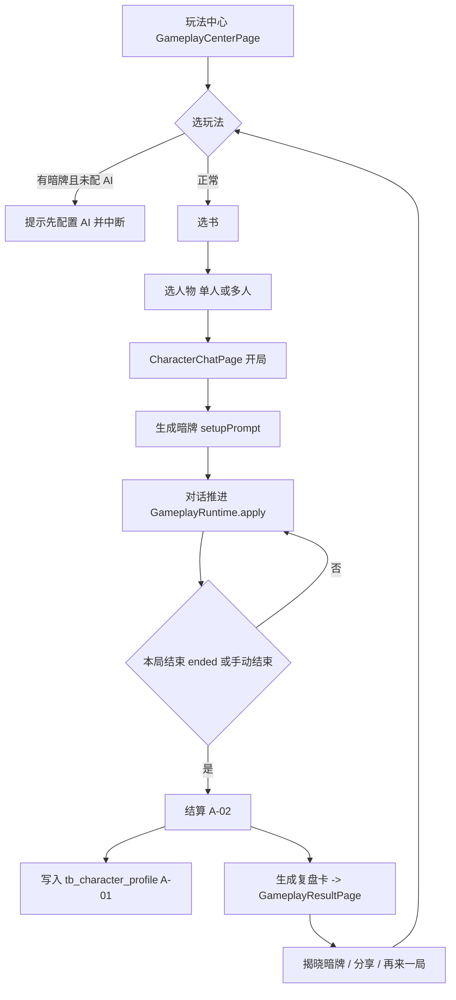
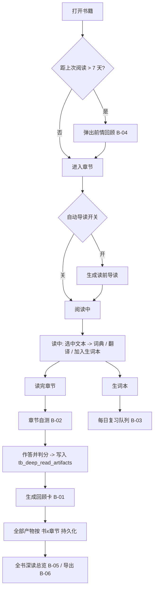
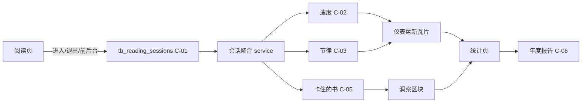

# 松江阅 · 新功能 PRD

| 项 | 内容 |
| --- | --- |
| 项目 | 松江阅 · SongJiang Reader（`D:\xiangmu\sojiangyue`） |
| 技术栈 | Flutter 3.35.3 / Dart 3.5+，Riverpod + sqflite，跨平台（Windows / macOS / Linux / iOS / Android / OHOS / Web） |
| 文档语言 | 简体中文 |
| 版本 | v1.0 |
| 日期 | 2026-10-07 |
| 作者 | 许清楚（产品） |
| 范围 | 三个方向：① 角色×玩法生态 ② AI 深度阅读增强 ③ 阅读数据与洞察 |

---

## 1. 项目信息

### 1.1 原始需求

在松江阅现有能力之上，沿三条产品线继续加深，不做推倒重来：

1. **角色×玩法生态** —— 角色养成、玩法运行时与玩法包生态
2. **AI 深度阅读增强** —— 在既有 AI 深读（读前导读 → 读中词典/翻译 → 读后自测与回顾卡）之上继续加深
3. **阅读数据与洞察** —— 在既有阅读时长统计与热力图之上升级

### 1.2 现有能力盘点（均对应真实代码，供架构师定位）

| 方向 | 现有能力 | 代码位置 |
| --- | --- | --- |
| 角色 | 人物卡 / 关系五元组（trust · affection · powerGap · conflictPoint · hiddenAttitude）/ 世界观 / 时间线，4 张表 | `lib/models/character_card.dart`、`lib/dao/character_schema.dart`（v11，`avatar_path` 为 v14 追加） |
| 角色 | 自设卡 / 跨书场景 / 原著知识 / 剧情回顾，4 张表 | `lib/dao/character_extras_schema.dart`（v13） |
| 角色 | 角色对话会话与消息，2 张表 | `lib/dao/character_chat_schema.dart`（v12） |
| 角色 | 人物蒸馏（切片规划、增量跳过、进度回调、可停止） | `lib/service/character/character_distill_service.dart`、`distill_background.dart`、`distill_snapshot.dart` |
| 角色 | 字段 AI 补全（6 字段，需用户确认才写库） | `lib/service/character/character_enrich_service.dart` |
| 角色 | 由蒸馏产物构建扮演 system prompt（含玩法指令注入） | `lib/service/character/character_persona.dart`、`character_chat_service.dart` |
| 角色 | 人物图谱导入导出 `.sjpack.zip` | `lib/service/enhancement_pack/enhancement_pack_service.dart` |
| 角色 | 角色列表 / 详情 / 编辑 / 对话 / 会话列表 / 清理 / 关系图 / 时间线 / 知识 / 剧情回顾 / 跨书茶馆 / 卡片库 | `lib/page/character/`（13 个页面），入口在 `lib/page/book_detail.dart` |
| 玩法 | 玩法运行时：状态量（stats）、分幕（phases）、暗牌（setupPrompt/secret）、结局判定（endingHint），模型用 `<sj-state>` 块申报变化 | `lib/models/gameplay_mode.dart`、`lib/service/gameplay/gameplay_runtime.dart` |
| 玩法 | 9 个内置玩法（剧本杀 / 海龟汤 / 规则怪谈 / 恋爱模拟 / 未寄出的信 / 角色辩论 / 元叙事 / 盲盒开局 / 跨书茶馆） | `lib/service/gameplay/gameplay_modes.dart` |
| 玩法 | 对局状态持久化，表 `tb_gameplay_sessions` | `lib/models/gameplay_session.dart`、`lib/dao/gameplay_schema.dart`（v15）、`lib/dao/gameplay_dao.dart` |
| 玩法 | 玩法包三类型（reading_script / reading_challenge / scene_card）、`.sjgame.zip` 导入导出、激活为插件注入 `PluginRegistry`、名场面卡分享 | `lib/service/gameplay/gameplay_pack_models.dart`、`gameplay_pack_service.dart`、`gameplay_pack_market_client.dart`（SHA256 + URL 沙箱） |
| 玩法 | 玩法中心（底部导航常驻 tab，受 `BookshelfPrefs.bottomNavShowGameplay` 控制）、玩法包市场弹窗 | `lib/page/gameplay/gameplay_center_page.dart`、`gamepack_market_dialog.dart`、`lib/page/home_page.dart` |
| AI 深读 | 9 套提示词模板，含读前导读 / 章节自测 / 章节回顾卡 | `lib/enums/ai_prompts.dart`（`AiPrompts.chapterPreview` / `chapterQuiz` / `chapterRecap`） |
| AI 深读 | 阅读页 AI 面板（右/下分栏、popup/split 三种显示），快捷提示芯片按「读前 → 读中 → 读后」排序 | `lib/page/reading_page.dart`（`_getAiQuickPromptChips()`） |
| AI 深读 | 15 个 AI 工具：当前章节正文、按 href 取章节、目录、全书检索、笔记检索、阅读历史、当前阅读元数据、书架整理、思维导图、标签等 | `lib/service/ai/tools/` |
| AI 深读 | 统一 AI 会话解析（新 provider 体系优先，旧 `aiConfig_*` 回退）、密钥轮转、缓存、历史 | `lib/service/ai/current_ai_pipeline.dart`、`ai_key_rotator.dart`、`ai_cache.dart`、`ai_history.dart` |
| AI 深读 | 生词/难句本（含 `reviewCount` / `lastReviewTime` 字段） | `lib/models/vocab_item.dart`、`lib/dao/vocab.dart`、`lib/page/vocab_list_page.dart` |
| 数据洞察 | 阅读时长按日/周/月/年聚合、按书聚合、按天分组 | `lib/dao/reading_time.dart`（表 `tb_reading_time`，字段仅 `book_id` / `date` / `reading_time`） |
| 数据洞察 | 12 个统计 Provider：热力图、连续天数、7/30 天趋势、今日目标、总量、笔记统计、完成进度、单书每日 | `lib/providers/`（heatmap_data / reading_streak / reading_duration_trend / daily_reading_goal 等） |
| 数据洞察 | 13 种可拖拽编排的仪表盘瓦片 | `lib/widgets/statistic/dashboard_tiles/dashboard_tile_registry.dart` |
| 数据洞察 | 统计页（仪表盘 + 图表卡 + 按书列表） | `lib/page/home_page/statistics_page.dart` |
| 基建 | 长任务 manifest 状态机（pending/running/done/failed/canceled + 进度，支持断点续跑） | `lib/service/long_task/task_manifest.dart`、`lib/page/long_task/long_task_center_page.dart` |
| 基建 | 数据库当前版本 v15 | `lib/dao/database.dart` |

---

## 2. 产品定义

### 2.1 产品目标

**统一目标**：让「读过的书」留下可积累的资产——读时在书里留下理解（深读），读完在人物身上留下关系（养成），长期在数据里留下轨迹（洞察），三者互相供能，使松江阅从「阅读器」变为「越用越懂你的阅读伴侣」。

| 方向 | 一句话目标 |
| --- | --- |
| ① 角色×玩法生态 | 让角色与读者的关系跨局累积、看得见成长，并让玩法包里的「挑战/名场面」真正跑起来而不是只展示。 |
| ② AI 深度阅读增强 | 把一次性问答式的 AI 深读，升级为按书×章节沉淀、可作答判分、可复习的深读闭环。 |
| ③ 阅读数据与洞察 | 把「读了多少分钟」升级为「读得怎么样」——补上会话粒度数据，产出速度、节律、目标与年度报告。 |

**可衡量目标（本迭代）**

| 指标 | 目标值 |
| --- | --- |
| 玩法局结束后产生可回看成果（复盘卡 / 关系变化）的比例 | 100%（P0 内建） |
| 已安装读书挑战中带实时进度条的比例 | 100%（当前为 0） |
| 同一本书重复提问同一章节时，AI 深读命中本地缓存的比例 | ≥ 80% |
| 统计页可查看的洞察维度数 | 从 13 种瓦片提升到 ≥ 17 种 |
| 阅读数据字段覆盖 | 从「书 × 日 × 秒」扩展到含会话开始/结束时间与阅读进度 |

### 2.2 用户故事

#### 方向 ①：角色×玩法生态

1. 作为**喜欢和书中人聊天的读者**，我希望和林黛玉聊过的好感度能跨会话累计、并在人物页看到「我们已经聊了 12 局、好感 68」，以便我能感到这段关系是真的在推进，而不是每次开新局都从零开始。
2. 作为**刚读完一局剧本杀的读者**，我希望结束后立刻看到一张复盘卡（我用了几回合、问出几条线索、真相是什么、哪句话让线索+1），以便我知道自己这局打得好不好，也愿意再来一局。
3. 作为**想养成阅读习惯的读者**，我希望玩法包里的「每日 30 分钟 × 7 天」挑战能显示今天是第几天、已完成多少、还剩多少，以便我被真实进度推着读，而不是看到一行静止的文字。
4. 作为**想把名场面分享出去的读者**，我希望选中一句划线就能生成一张带书名与排版的名场面卡片并保存为图片，以便我能直接发到社交平台。
5. 作为**想看两个角色吵架的读者**，我希望在开「跨书茶馆」时能一次选多位人物同场，以便我不用为每个人单独开一局再自己脑补对手戏。

#### 方向 ②：AI 深度阅读增强

1. 作为**读长篇容易忘的读者**，我希望每次打开一本书时能看到上次读到哪、AI 已自动备好的「前情回顾」，以便我不必翻回去重读就能接上。
2. 作为**想检验自己读懂没的读者**，我希望章节自测能直接在卡片上点选作答并立刻得到对错与解释，以便我不是对着一段纯文本自己批改。
3. 作为**读外文书的读者**，我希望生词本能按遗忘规律每天推给我 10 个待复习词、并在我点「记住了/忘了」后调整下次出现时间，以便我真的把这些词留住。
4. 作为**长期读一本书的读者**，我希望 AI 生成的导读、自测成绩、回顾卡都按书×章节存下来，以便我能回看整本书的深读轨迹，且不会重复烧 token。
5. 作为**做读书笔记的读者**，我希望一本书读完后能把所有回顾卡 + 我的划线一键导出成一份 Markdown，以便我把它放进自己的知识库。

#### 方向 ③：阅读数据与洞察

1. 作为**想知道自己读得多快的读者**，我希望统计页能告诉我「这本书平均 28 页/小时」，以便我估算读完剩下的还要多久。
2. 作为**上班族读者**，我希望看到自己一周里通常在几点读、一次读多久、哪天最容易断，以便我把阅读安排进真实的作息里。
3. 作为**想坚持每日阅读的读者**，我希望可以自己设一个每日目标（如 30 分钟或 20 页）并看到连续达成天数，以便我有明确的反馈而不是只有一条总时长。
4. 作为**年底想做总结的读者**，我希望有一份年度阅读报告（总时长、读完本数、最快/最慢的书、最活跃的月份、读得最多的时段）并能导出成图分享，以便我能回顾这一年的阅读。
5. 作为**同时读好几本书的读者**，我希望洞察能告诉我我在哪本书上「卡住了」（很久没动但进度 60%+），以便我决定是捡起来还是放弃。

---

## 3. 需求池

优先级：**P0 = 本迭代必须交付**；**P1 = 应当交付，可顺延一个迭代**；**P2 = 有则更好**。

> **架构裁定（2026-10-07，经架构师实地核码确认）**
> 1. WebDAV 同步是**整库快照替换**（`lib/dao/database.dart` `prepareUploadSnapshot()` 走 `VACUUM INTO`，`DatabaseSyncManager` 下载后原子替换整个库文件；`lib/service/sync/**` 内无按表 SQL）。因此「让某张表不进同步」无法靠"不注册"实现。故：`tb_character_profile` 进主库 v16；`tb_deep_read_artifacts` 与 `tb_reading_sessions` 进**新建的独立本地库 `local_cache.db` v1**，永不参与同步，`sync/` 零改动。
> 2. A-02 结算采用**对全部已结束对局的确定性重算**（幂等），不做增量累加。原因：`_statsBeforeTurn` 只回滚 `stats`，`GameplayRuntime.apply` 中 `ended` 是单调或、不可回退，按增量累加会在「重新生成」时二次计入。
> 3. 本节 A-01 验收 4、B-01 验收 1/5、C-01 验收 5 为据此新增或修订的条款。

| 编号 | 需求名 | 方向 | 优先级 | 简要描述 | 验收标准（可验证） |
| --- | --- | --- | --- | --- | --- |
| A-01 | 角色养成档案 | ① | P0 | 新增跨对局持久的「读者 × 角色」关系档案：羁绊等级、好感累计、对局数、总回合数、最近交互时间、里程碑。新增表 `tb_character_profile`（book_id, character_name, bond_level, affection_total, session_count, turn_count, last_played_at, milestones JSON）。 | 1) 表随 DB 迁移至 v16 创建，老库升级不丢数据；2) 同一角色开 3 局后，档案中 `session_count == 3`、`turn_count` 等于各局回合数之和；3) 人物详情页可见档案区块且数值与库一致；4) **删除或清空角色对话会话，不削减已结算的 `affection_total` / `bond_level`**（羁绊一经获得即保留；重置只能走人物档案页的显式入口）。机制：结算写入账本表 `tb_character_profile_events`，其 `gameplay_session_id` **不建外键**——对局行会被会话删除级联删掉，账本必须活得更久；5) UI 文案须为「对局数 / 总回合」，**不得**写成「对话数」——清空对话按既有语义会重新开局，重玩后对局数 +1 属自洽行为。 |
| A-02 | 玩法局结算与复盘卡 | ① | P0 | 对局结束（`GameplaySession.ended == true` 或用户手动结束）时：把本局 stats 增量结算进 A-01 档案，并生成复盘卡（玩法名、书名、人物、回合数、分幕进度、最终状态量、关键事件 log、暗牌揭晓入口）。复盘卡可回看、可分享。 | 1) 采用**重算口径**：档案值 = 全部已结束对局贡献的确定性重算结果，因此「结算后的值 − 结算前的值」恒等于本局 `isScore` 状态量变化之和；2) 复盘卡展示的事件条数与 `tb_gameplay_sessions.log` 中记录一致；3) 从会话列表可回看历史对局的复盘卡（依赖 T03 修复 `_open()` 未传 `gameplayMode` 的既有缺陷）；**复盘卡生命周期跟随对话**——删除该对话后复盘卡一并消失，账本只承载羁绊，不承载复盘明细；4) 「重新生成」后档案值自动回到正确值，不重复计入。 |
| A-03 | 读书挑战进度追踪 | ① | P0 | 让 `GameplayPackType.readingChallenge` 从「只展示一行文字」变为「有进度、有状态」：按 `ReadingChallenge.metric`（daily_minutes / daily_pages / weekly_books）从 `tb_reading_time` 实时计算进度，展示周期第 N 天、已完成/目标、达成状态（进行中/已达成/已过期）。 | 1) 挑战卡片显示进度条且百分比 = 已完成值 / target（误差 ≤ 1%）；2) `daily_minutes` 取值与 `readingTimeDao.selectTodayReadingSeconds()` 一致；3) 达成后状态变为「已达成」并保留记录；4) `daily_pages` 在 P0 阶段标记为「待 C-01 提供页数数据」，UI 显示「暂不可用」而非错误数字。 |
| B-01 | 深读产物持久化 | ② | P0 | 新增表 `tb_deep_read_artifacts`（book_id, chapter_href, chapter_title, kind ∈ {preview, quiz, recap, summary}, content JSON, model, created_at, updated_at）。AI 生成导读/自测/回顾卡后落库；再次进入同一书×章节×kind 时优先读本地，并提供「重新生成」。 | 1) 同一设备同一章节第二次点「导读」时不再发起模型请求（以 AI 请求日志为据），直接展示库内内容；2) 点「重新生成」后 `updated_at` 变化且内容被覆盖；3) **删除书籍时跨库级联清理本表**（该表在 `local_cache.db`，不会继承 `deleteReadingTimeByBookId` 的清理路径，需在删除书籍的调用点显式补一次清理，禁止留孤儿行）；4) 缓存命中率在同一会话内重复访问时 = 100%；5) 本表不随 WebDAV 同步，换设备后需重新生成——属预期行为，UI 不提示错误。 |
| B-02 | 章节自测答题闭环 | ② | P0 | 把 `AiPrompts.chapterQuiz` 从纯文本输出升级为结构化题目：模型返回约定 JSON（题干、选项、正确答案、解析），UI 渲染为可点选的答题卡，作答后即时判分并展示解析，成绩写入 `tb_deep_read_artifacts`（kind=quiz 的 content 中含 score/answered_at）。 | 1) 模型返回非法 JSON 时降级为纯文本展示，不崩溃、不空白；2) 选错选项后立刻标红并展示解析；3) 同一章节的作答记录可回看，分值一致；4) 至少 3 道选择题能被正确渲染与判分。 |
| C-01 | 阅读会话采集 | ③ | P0 | 新增表 `tb_reading_sessions`（id, book_id, started_at, ended_at, duration_seconds, start_percentage, end_percentage, chapter_title）。在阅读页进入/退出、前后台切换时写入一次会话记录；`tb_reading_time` 的写入逻辑保持不变（不破坏同步）。 | 1) 一次连续阅读产生 1 条会话记录，`duration_seconds` 与同期写入 `tb_reading_time` 的增量差值 ≤ 60 秒；2) 中途退到后台再回来不产生重复记录（同一 book + 间隔 < 阈值视为续接）；3) 该表落 `local_cache.db`，**不进入** WebDAV 同步范围；4) 老用户升级后历史数据为空但页面不报错；5) 因数据为本设备局部，速度 / 节律 / 单次时长类 UI 需带一处轻量说明「本设备数据」（C-08 的正式评估留到 P2）。 |
| C-02 | 阅读速度洞察 | ③ | P0 | 基于 C-01 的 `start_percentage / end_percentage` 与 `duration_seconds`，按书计算「预计页/小时」与「读完剩余预计时间」；在书籍详情与统计页展示。页数缺省时用进度百分比折算。 | 1) 单书速度 = Σ(Δ进度 × 总页估算) / Σ时长，与手工核算误差 ≤ 5%；2) 书籍详情展示「约 X 页/小时 · 剩余约 Y 小时」；3) 会话数 < 3 条时显示「数据不足」而非给出不可靠数字。 |

### 3.2 P1（应当交付）

| 编号 | 需求名 | 方向 | 优先级 | 简要描述 | 验收标准（可验证） |
| --- | --- | --- | --- | --- | --- |
| A-04 | 多角色同场选人 | ① | P1 | 支持 `crossover-chat` 等多人玩法一次选 2–4 位人物（可跨书），场景存入 `tb_crossover_scenes`（已有 members 字段），并在人物注入时按 `character_persona.dart` 的多人 prompt 分支拼装。 | 1) 可勾选 2–4 人并可跨书选择；2) 开场白中出现全部被选人物且各自立场不混淆；3) 场景可保存到 `tb_crossover_scenes` 并在跨书茶馆页复用。 |
| A-05 | 名场面卡本地生成 | ① | P1 | 从选中划线/笔记一键生成 `SceneCard`（已有模型），渲染为图片（复用现有笔记分享卡片渲染链路 + `saver_gallery`），支持保存到相册与系统分享。 | 1) 选一句划线 → 生成卡片图片耗时 < 3 秒；2) 图片含书名、章节、引文与松江阅水印；3) 生成的卡片回写进玩法包清单可被再次导出（复用 `exportPack`）。 |
| A-06 | 挑战成就联动 | ① | P1 | 挑战达成时解锁成就条目（复用 `ReadingChallenge.rewardAchievement` 字段），在玩法中心展示「我的成就」列表与达成时间。 | 1) 达成挑战后成就列表新增 1 条且带时间戳；2) 已解锁成就在重启后仍存在（持久化）；3) 重复达成不产生重复条目。 |
| B-03 | 生词间隔复习 | ② | P1 | 基于 `VocabItem.reviewCount / lastReviewTime`（字段已存在）实现轻量 SRS：每日待复习队列（默认 10 条）、「记得 / 忘了」两档反馈、按反馈调整下次复习间隔。 | 1) 未复习过的词优先出现在队列；2) 点「记得」后 `reviewCount + 1` 且下次出现时间延后；点「忘了」后当天可再次出现；3) 队列为空时展示空状态而非报错；4) `vocab_list_page` 新增「复习模式」入口；5) **「忘了」会使 `reviewCount` 回退 1**，故该字段语义变为「熟练档位」而非「复习次数」——UI 必须改展示为**熟练度 Lv.N**（N = `min(reviewCount, 7)`，0 档显示「尚未复习」），**不得**继续展示「已复习 N 次」（该文案现存在于 `vocab_list_page.dart:139` 与 `app_en/app_zh-CN/app_zh-TW` 三份 arb 的 `vocabReviewCount` 键，需一并改文案）。**这是改语义，不是删 UI**，不得移除该展示元素。 | 6) **生词列表的行点击（`ListTile.onTap`）不得变更熟练档位**，入口只保留 popup 菜单的「标记已复习」与复习模式内的显式「记得 / 忘了」按钮——理由见下。 |
| B-04 | 读前导读与断点续读 | ② | P1 | 进入章节时可选自动出「读前导读」（`chapterPreview`）；距上次阅读超过 N 天时，进书优先弹出「前情回顾」（`summaryThePreviousContent`）。二者结果走 B-01 落库。 | 1) 设置项可开关自动导读，默认关闭；2) 超 7 天未读的书再次打开时弹出前情回顾卡片，可一键关闭——**「上次阅读日」取主库 `tb_reading_time` 的 `MAX(date)`**（`local_cache.db` 的会话表老用户为空，用它会导致每本书都被判为"隔了很久"而疯狂弹窗）；查不到记录视为从未读过 → **不弹**；3) 二者均命中 B-01 缓存，不重复请求模型；4) 读前导读**静默预生成、不弹窗**，结果进深读页由读者主动查看；其可发现性用既有 `HintBanner` + 新增一个 `HintKey` 常量做**一次性非模态提示**（复用现有持久化机制）。 |
| C-03 | 阅读节律洞察 | ③ | P1 | 基于会话数据分析：时段分布（0–23 时热力）、星期分布、平均单次时长、最长单次时长、最长连续天数。新增 3–4 个仪表盘瓦片，注册进 `dashboard_tile_registry.dart`。 | 1) 时段分布各小时之和 = 会话总时长（误差 ≤ 1 分钟）；2) 新瓦片可在瓦片编辑模式中被添加/移除并持久化（`DashboardTilesState`）；3) 无会话数据（老用户）时展示引导文案。 |
| C-04 | 每日目标与连续达成 | ③ | P1 | 让 `daily_reading_goal` provider 从「只有今日秒数」升级为可配置目标（分钟/页二选一）+ 连续达成天数 + 达成历史。目标存本地配置。 | 1) 可设置目标并立即生效；2) 达成当天后连续天数 +1，断一天后归零重新计；3) 统计页显示「今日 X / 目标 Y」进度环；4) 目标值在重启后保持。 |
| C-05 | 洞察页与卡住的书 | ③ | P1 | 统计页新增「洞察」区块：当前在读、卡住的书（进度 ≥ 60% 且 N 天未动）、本月最快/最慢的书。 | 1) 「卡住的书」判定规则可复现（进度阈值与天数阈值写为常量）；2) 点击卡片跳转 `book_detail.dart`；3) 列表为空时展示空状态。 |

### 3.3 P2（有则更好）

| 编号 | 需求名 | 方向 | 优先级 | 简要描述 | 验收标准（可验证） |
| --- | --- | --- | --- | --- | --- |
| A-07 | 玩法成就徽章墙 | ① | P2 | 按玩法类型/累计局数/最高分发放徽章，在玩法中心以徽章墙展示。 | 徽章解锁条件可用单元测试覆盖；展示与实际解锁状态一致。 |
| A-08 | 玩法包内嵌玩法模式 | ① | P2 | 扩展 `GameplayPackType`，允许包内声明自定义 `GameplayMode`（stats/phases/setupPrompt），与内置玩法并列出现在玩法中心。 | 1) 导入含自定义玩法的包后，玩法中心出现该玩法；2) 非法 stats 定义被 `fromJson` 拒绝并给出明确报错（现有严格校验风格）；3) 契约测试覆盖。 |
| A-09 | 角色成长可视化 | ① | P2 | 把 A-01 的羁绊变化画成折线/里程碑时间轴，在人物详情展示。 | 时间轴条目顺序与档案更新时间一致；空数据时展示占位。 |
| B-05 | 全书深读总览 | ② | P2 | 按书汇总所有章节的导读/自测成绩/回顾卡，形成「这本书我读懂了多少」总览页。 | 总览页列出已做深读的章节数与平均分；未做章节显示为待完成。 |
| B-06 | 深读产物导出 | ② | P2 | 把回顾卡 + 划线导出为 Markdown（复用 `lib/service/notes/export_notes.dart` 的导出链路）。 | 导出文件可被常见 Markdown 编辑器正常打开；包含书名、章节与引文。 |
| B-07 | 深读长任务化 | ② | P2 | 把「整本书批量生成导读」挂到 `TaskManifestStore`，支持后台跑、可停止、断点续跑。 | 1) 任务出现在长任务中心且进度正确；2) 中途停止后已生成部分保留；3) 重启后可续跑。 |
| C-06 | 年度阅读报告 | ③ | P2 | 生成年度报告（总时长、读完本数、最快/最慢的书、最活跃月份、最常时段、最长连续），渲染为长图分享。 | 1) 报告数据与统计页一致；2) 可导出图片与系统分享；3) 数据不足时给出降级报告而非崩溃。 |
| C-07 | 数据导出 | ③ | P2 | 把阅读会话与统计结果导出为 CSV（复用 `csv` 依赖）。 | 导出的 CSV 行数与数据库记录数一致；含表头且中文不乱码。 |
| C-08 | 多端洞察同步评估 | ③ | P2 | 评估是否将 `tb_reading_sessions` 纳入 WebDAV 同步（**需评估 `server/` 与既有同步契约**）。 | 输出评估结论文档；若不做，明确说明多端洞察不一致的产品文案。 |

---

## 4. UI 设计描述

### 4.1 入口与路由总览（落到现有 `lib/page/` 结构）

```
底部导航 lib/page/home_page.dart
├── 书架      BookshelfPage
├── 统计      StatisticPage ────────────────┐
├── 笔记      NotesPage                      │
├── 设置      SettingsPage                   │
└── 玩法中心  GameplayCenterPage ────┐       │
                                     │       │
书籍详情 lib/page/book_detail.dart ──┤       │
└── 人物  CharacterListPage          │       │
    └── 人物详情 CharacterDetailPage │       │
        └── 开始对话 CharacterChatPage       │
                                             │
阅读页 lib/page/reading_page.dart            │
└── AI 面板（右/下分栏 · popup/split）        │
                                             │
统计页 lib/page/home_page/statistics_page.dart
└── 仪表盘 + 图表卡 + 按书列表
```

**新增页面（建议落盘位置）**

| 新增文件 | 用途 | 从哪进入 |
| --- | --- | --- |
| `lib/page/character/character_profile_page.dart` | 角色养成档案（A-01） | `character_detail_page.dart` 顶部新增「羁绊」区块 → 点进详情 |
| `lib/page/gameplay/gameplay_result_page.dart` | 对局复盘卡（A-02） | `character_chat_page.dart` 对局结束后自动弹出；`character_chat_sessions_page.dart` 历史回看 |
| `lib/page/gameplay/challenge_board_page.dart` | 挑战看板与成就（A-03 / A-06） | `gameplay_center_page.dart` 「读书挑战」分区标题右侧「全部」 |
| `lib/page/reading/deep_read_page.dart` | 深读档案与自测答题（B-01 / B-02 / B-05） | 阅读页 AI 面板新增「深读」Tab；`book_detail.dart` 新增入口 |
| `lib/page/statistics/reading_insight_page.dart` | 节律、速度、卡住的书（C-02 / C-03 / C-05） | `statistics_page.dart` 新增「洞察」区块 |
| `lib/page/statistics/annual_report_page.dart` | 年度报告（C-06，P2） | 统计页年度入口 |

### 4.2 方向 ①：角色×玩法生态

**流程：开一局 → 结算 → 沉淀到档案**



**角色详情页新增区块（ASCII 线框）**

```
┌──────────────────────────────────────────┐
│  ‹  林黛玉                       [编辑]  │
├──────────────────────────────────────────┤
│  [头像]  林黛玉                          │
│         身份：绛珠仙草 · 重要度 92        │
├──────────────────────────────────────────┤
│  ◈ 你们的关系                    详情 ›  │
│  羁绊 Lv.3 ──────●──────── 68/100        │
│  共读 12 局 · 87 回合 · 最近 3 天前      │
│  里程碑：初识 ─ 破冰 ─ 交心 ✔ ─ 知己     │
├──────────────────────────────────────────┤
│  性格 / 背景 / 动机 / 外貌  …（既有）    │
├──────────────────────────────────────────┤
│  [ 开始对话 ]  [ 开一局玩法 ]  [ AI 补全 ]│
└──────────────────────────────────────────┘
```

**对局复盘卡（ASCII 线框）**

```
┌──────────────────────────────────────────┐
│  剧本杀 · 结案                       ✕   │
│  《红楼梦》林黛玉                         │
├──────────────────────────────────────────┤
│  用时 14 回合 · 走完 4/4 幕              │
│                                          │
│  线索      ███████░░░  5/6               │
│  逼近真相  ████████░░  83/100            │
├──────────────────────────────────────────┤
│  关键推进                                │
│  · 第 4 轮：问出不在场证明                │
│  · 第 9 轮：识破第一条谎话                │
│  · 第 14 轮：指认真凶                    │
├──────────────────────────────────────────┤
│  本次羁绊 +12 → Lv.3（+18 到下一级）     │
├──────────────────────────────────────────┤
│  [ 揭晓本案真相 ]  [ 分享 ]  [ 再来一局 ] │
└──────────────────────────────────────────┘
```

**读书挑战卡片（改造前后对比）**

```
改造前：
│ 🚩 七日阅读打卡 · 每日分钟 30 / 7天 · 成就:reader7 │

改造后：
│ 🚩 七日阅读打卡              第 4 / 7 天          │
│    今日 22 / 30 分钟  ███████░░░  73%            │
│    已达标 3 天 · 连续 3 天                       │
│    [ 详情 › ]                                    │
```

**交互要点**
- 玩法状态条（`character_chat_page.dart` 的 `_buildGameplayBar`，32dp 高）保持单行横滚，复盘入口放在 AppBar actions 的「⋯」菜单或结束后自动弹窗，避免挤占现有状态条。
- 复盘卡弹出后，返回键不丢失（用 `Navigator.push` + 结果回调，与现有 `_startMode` 的 push 方式一致）。
- 未配置 AI 时的拦截沿用现有 `resolveCurrentModel() == null` 判定与提示文案风格。
- **已知既有缺陷（须随 A-02 修复）**：`lib/page/character/character_chat_sessions_page.dart` 的 `_open()` 推 `CharacterChatPage` 时未传 `gameplayMode`，从会话列表重开历史对局时玩法运行时不加载，A-02 验收 3 无法成立。修复思路：由 `gameplayDao.getByChatSession(session.id)` 取 `modeId`，再在 `kBuiltinGameplayModes` 中解析出 `GameplayMode` 传入（无需改表）。

### 4.3 方向 ②：AI 深度阅读增强

**流程：进入章节 → 深读闭环**



**阅读页 AI 面板改造（保留现有分栏/弹窗逻辑，新增一个 Tab）**

```
┌────────────────────────────┐
│ [ 对话 ]  [ 深读 ]  [ ⋯ ]  │   ← 新增 Tab
├────────────────────────────┤
│ 本章 · 第三回              │
│                            │
│ 读前导读   ✔ 已生成  重生成│
│ 章节自测   未作答    去做 ›│
│ 回顾卡     ✔ 已生成  查看 ›│
│ 本章总结   —         生成 ›│
│                            │
│ ── 我的深读轨迹 ────────── │
│ 第1回 ✔ ✔ ✔   第2回 ✔ ✗ ✔ │
└────────────────────────────┘
```

**章节自测答题卡（ASCII 线框）**

```
┌──────────────────────────────────────────┐
│  章节自测 · 第三回            2 / 3      │
├──────────────────────────────────────────┤
│  2. 宝玉为何在此处沉默？                  │
│                                          │
│  ( ) A. 未曾听懂                         │
│  (●) B. 心有所感却不欲言   ← 已选        │
│  ( ) C. 急于离开                         │
│  ( ) D. 与黛玉赌气                       │
├──────────────────────────────────────────┤
│  ✔ 答对了                                │
│  解析：前文已铺垫他两次欲言又止……        │
├──────────────────────────────────────────┤
│              [ 下一题 ]  [ 查看成绩 ]     │
└──────────────────────────────────────────┘
```

**生词复习卡片（ASCII 线框）**

```
┌──────────────────────────────────────────┐
│  今日复习  3 / 10                        │
├──────────────────────────────────────────┤
│         窸窣  xī sū                       │
│         ─────────────                    │
│  形容细小的摩擦声。                      │
│  出处：《红楼梦》第三回                  │
│                                          │
│  上次复习：6 天前 · 已复习 2 次          │
├──────────────────────────────────────────┤
│     [ 忘了 ]              [ 记得 ]        │
└──────────────────────────────────────────┘
```

**交互要点**
- 深读 Tab 只在 `AiPrefs` 已配置可用 AI 时显示可生成按钮；未配置时展示「先配置 AI」的占位（沿用 `resolveCurrentModel()` 判定）。
- 自测题目 JSON 解析失败必须降级为现有纯文本展示，不允许出现空白页或崩溃。
- 所有深读产物写入走统一的 service（建议 `lib/service/ai/deep_read_service.dart`），UI 不直接碰 DAO。

### 4.4 方向 ③：阅读数据与洞察

**流程：采集 → 计算 → 呈现**



**统计页新增区块（改造后布局）**

```
┌──────────────────────────────────────────┐
│  统计                          [ 编排 ]  │
├──────────────────────────────────────────┤
│  ┌────────┐ ┌────────┐ ┌────────┐       │
│  │ 阅读日 │ │ 书籍   │ │ 笔记   │  …既有 │
│  └────────┘ └────────┘ └────────┘       │
│  ┌────────┐ ┌────────┐                  │
│  │ 速度   │ │ 节律   │    ← 新增    │
│  │ 28页/h │ │ 21-23时│  本设备数据  │
│  └────────┘ └────────┘              │
├──────────────────────────────────────────┤
│  今日目标            21 / 30 分钟        │
│  ███████░░░  连续 5 天          ← 新增   │
├──────────────────────────────────────────┤
│  洞察                              ›     │
│  · 卡住的书：《XXX》68%，已 23 天未读    │
│  · 本月最快：《YYY》41 页/小时           │
├──────────────────────────────────────────┤
│  按书阅读时长列表（既有 DateBooks）      │
└──────────────────────────────────────────┘
```

**新仪表盘瓦片（注册进 `dashboard_tile_registry.dart`）**

| 瓦片枚举（新增） | 内容 | 依赖 |
| --- | --- | --- |
| `readingSpeed` | 平均页/小时（全局或当前书） | C-01 + C-02 |
| `readingRhythm` | 最常阅读时段 + 星期分布迷你条 | C-03 |
| `sessionAverage` | 平均单次时长 / 最长单次 | C-01 |
| `dailyGoalRing` | 今日目标进度环 + 连续天数 | C-04 |

**交互要点**
- 新瓦片必须遵守现有 `StatisticsDashboardTileBase` 契约，可在编排模式中增删并随 `DashboardTilesState` 持久化。
- 老用户无会话数据时，所有新瓦片统一显示「继续阅读以生成洞察」，不得显示 0 或 NaN。
- `tb_reading_sessions` 不纳入 WebDAV 同步（见 C-08），需在统计页给出「本设备数据」的轻量说明。

---

## 5. 数据与迁移影响（供架构师参考，非最终方案）

| 变更 | 说明 |
| --- | --- |
| 主库 | v15 → v16，新增 `tb_character_profile`（读者资产，随库同步），沿用 `ensureSchemaIntegrity` 兜底 |
| 独立本地库 | 新建 `local_cache.db` v1，承载 `tb_deep_read_artifacts`、`tb_reading_sessions`，**永不参与 WebDAV 同步** |
| 为何分库 | 同步为整库快照替换（`VACUUM INTO` + 原子替换），表只要在主库就必然被同步并在对端覆盖，无法靠"不注册"排除；分库后 `lib/service/sync/**` 与 `lib/providers/sync.dart` 零改动 |
| 跨库注意 | 分库表**不会继承** `deleteReadingTimeByBookId` 的级联清理，删书需显式补清理；新 DAO 需自带建表与完整性兜底 |
| 复用优先 | A-01 复用 `characterDao`；A-03 复用 `readingTimeDao`；B-01/B-02 复用 `ai_prompts.dart` + `AiToolRegistry`；C-01/C-02 复用 `reading_time.dart` 的聚合写法；新瓦片复用 `dashboard_tile_registry.dart` |
| 不改动 | `tb_reading_time` 结构与同步契约保持不变（避免影响 WebDAV）；`GameplayRuntime` 的 `<sj-state>` 协议保持不变 |
| 需评估 | C-08 是否把 `tb_reading_sessions` 纳入同步（涉及 `server/` 与既有同步契约，本迭代默认不做，改为 UI 标注「本设备数据」） |
| 不建议 | 任何需要后端重做的方案；本 PRD 所有 P0/P1 均可在端上闭环 |

---

## 6. 待确认问题

以下需要主理人与用户拍板，会直接影响架构设计：

| # | 问题 | 备选方案 | 影响 |
| --- | --- | --- | --- |
| 1 | 角色养成档案的作用域：**按「读者 × 角色」**还是**「读者 × 角色 × 书」**？同一人物在跨书茶馆里出现时，羁绊是否共享？ | A. 按书隔离（更严谨） B. 全局共享（更适合跨书玩法） | 决定 `tb_character_profile` 的唯一索引与 A-04 的选人逻辑 |
| 2 | 羁绊数值的来源：只累加标记了 `isScore` 的状态量，还是所有状态量都参与？是否需要衰减（久不聊会掉）？ | A. 仅 isScore，不衰减 B. 全部状态量加权，含衰减 | 影响 A-02 结算公式与「里程碑」阈值设定 |
| 3 | ~~读书挑战的 `daily_pages` 度量依赖页数数据…~~ | **已决策：接受降级**（P0 标为「暂不可用」，待 C-01 用进度百分比折算） | 已闭环 |
| 4 | ~~AI 深读产物（B-01）是否需要随 WebDAV 多端同步？~~ | **已决策：不同步**（用户决策 #3）。实现方式由架构裁定为独立本地库 `local_cache.db`，见第 5 节 | 已闭环 |
| 4c | ~~前情回顾加「≥7 天」门控，是否改变老用户既有体验？~~ | **已决策：采纳门控**。依据：`autoSummaryPreviousContent` 默认 false，影响面仅限主动开启者；且现行为"每次进书都弹"对每日阅读者是噪音并白耗 token，门控是把功能拉回其本意（隔了很久才需要回顾） | 已闭环 |
| 4e | ~~生词列表 `ListTile.onTap` 是否保留"点一下整行即 +1 档"？~~ | **已决策：去掉 onTap，保留 popup 菜单入口**。依据：`markReviewed` 会同时写 `last_review_time = now`，误触会把该词**直接从今日复习队列踢出并推迟 1~60 天**，是功能性破坏而非显示瑕疵；且能力与可发现性不受损（菜单项保留 + 复习模式有显式按钮） | 已闭环（属既有交互变更，需登记进架构 §9 决策清单） | | **已决策：静默预生成、不弹窗**（弹窗打断阅读流）。可发现性由深读 Tab 的「✔ 已生成」标记 + 一次性 `HintBanner` 提示承担 | 已闭环 | | **已决策：保留**（羁绊一经获得即保留；重置走人物档案页显式入口，P2）。**已定实现：账本表** `tb_character_profile_events` | 已闭环。注：备选「冗余列」方案**已否决**——`character_chat_dao.dart` 的 `deleteSession`/`deleteSessions` 已存在对 `tb_gameplay_sessions` 的**主动级联删除**，冗余列会随行一起被删 |
| 5 | 章节自测（B-02）要求模型返回结构化 JSON。若用户使用的小模型不稳定，是否接受**部分降级**（JSON 失败时退回纯文本，不计分）？ | A. 接受降级（推荐） B. 强制 JSON，失败即报错重生成 | 影响提示词设计与错误处理的复杂度 |
| 6 | 阅读会话（C-01）的「续接阈值」定为多少分钟？超过阈值视为新会话，未超过视为同一次。 | A. 5 分钟 B. 15 分钟 C. 30 分钟 | 影响平均单次时长与节律统计的口径 |
| 7 | 年度报告（C-06）与名场面卡（A-05）都需要把内容渲染成图片。是否统一复用现有笔记分享卡片的渲染链路，还是新建一套？ | A. 复用 B. 新建 | 影响工作量与视觉一致性 |
| 8 | 玩法中心目前是底部导航常驻 tab。P0 新增的挑战看板、成就入口是否会造成该页过重，需要拆成二级页还是做成顶部分段控件？ | A. 分段控件（推荐，改动小） B. 拆二级页 | 影响 `gameplay_center_page.dart` 的重构范围 |
| 9 | 是否需要为 P0 的三张新表补契约测试（对齐现有 `test/contract/` 风格）？ | A. 需要 B. 只补关键路径 | 影响测试工作量 |
| 10 | 三个方向的优先级排序是否与用户预期一致？P0 中角色（3 条）、深读（2 条）、数据（2 条）的配比是否可接受？ | A. 维持当前配比 B. 调整 | 影响迭代排期 |

---

## 7. 非目标（本迭代不做）

- 不重构 `GameplayRuntime` 的 `<sj-state>` 协议（当前工作良好，仅在其上做结算扩展）。
- 不改动 `tb_reading_time` 表结构与 WebDAV 同步契约。
- 不新增需要 `server/` 后端改造的能力（C-08 仅做评估）。
- 不做社交/多人在线玩法（无后端支撑）。
- 不做 UI 视觉体系的大改（沿用 `lib/design/songjiang/` 令牌与组件）。
